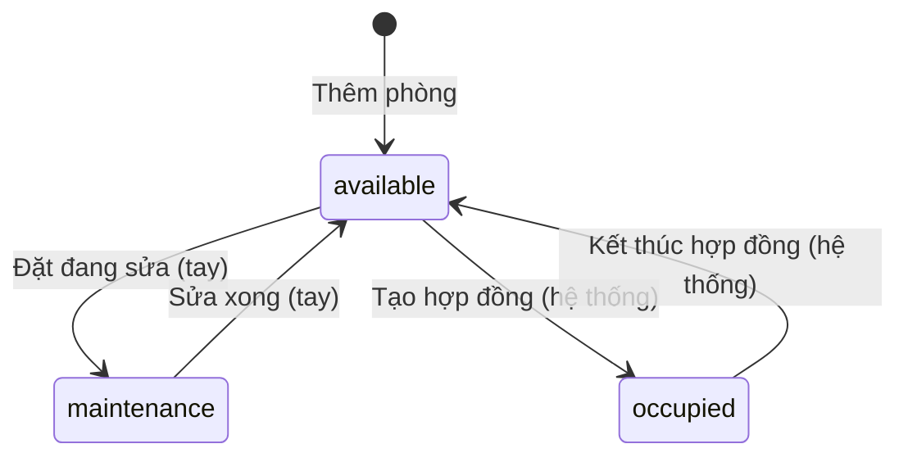
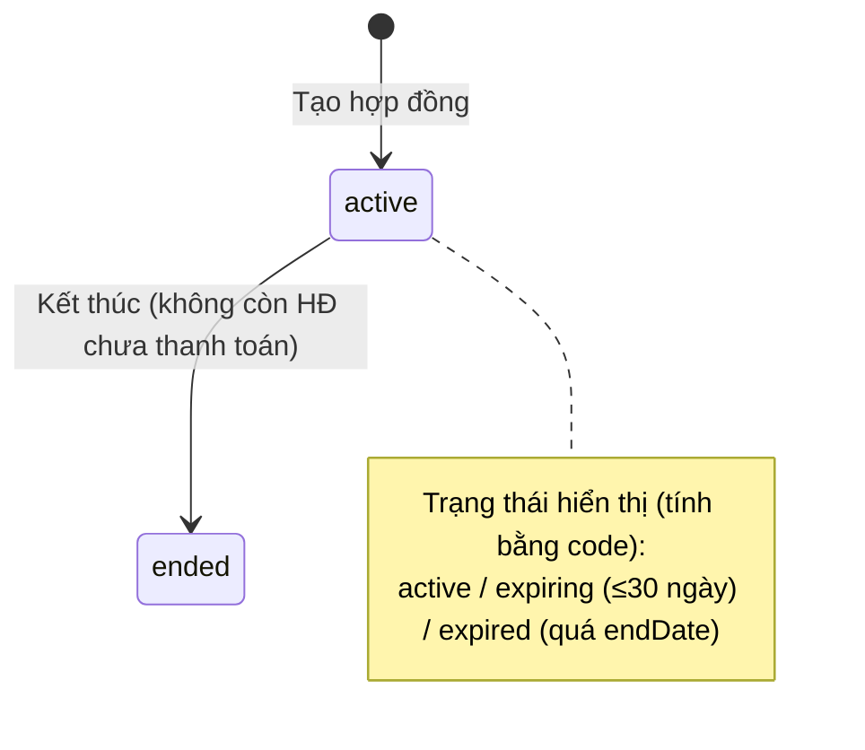
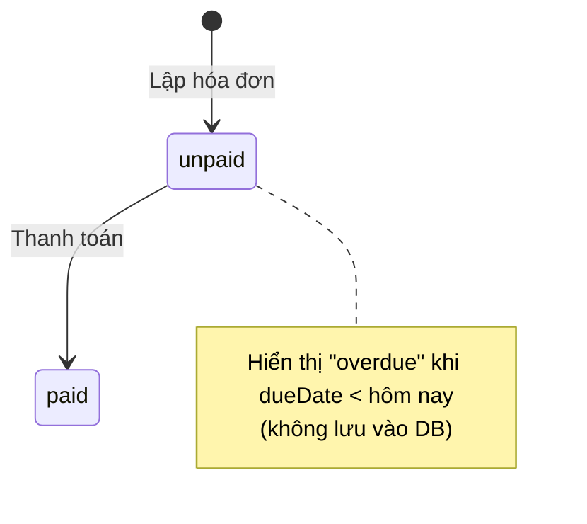
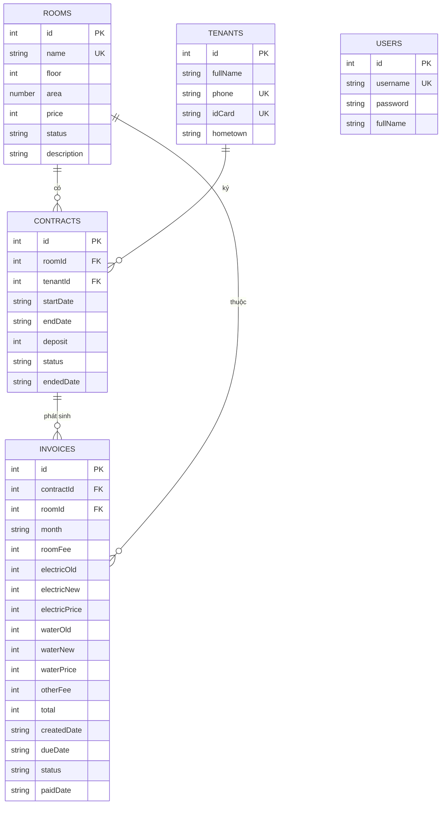
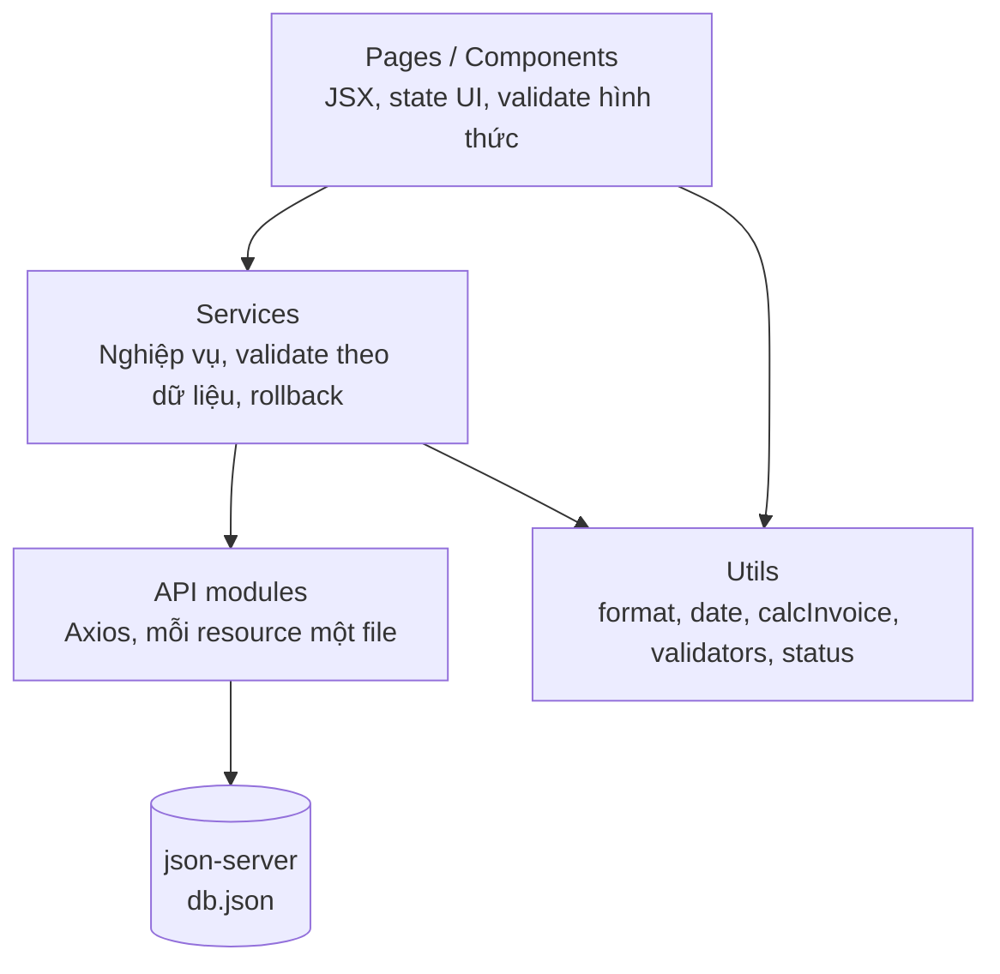
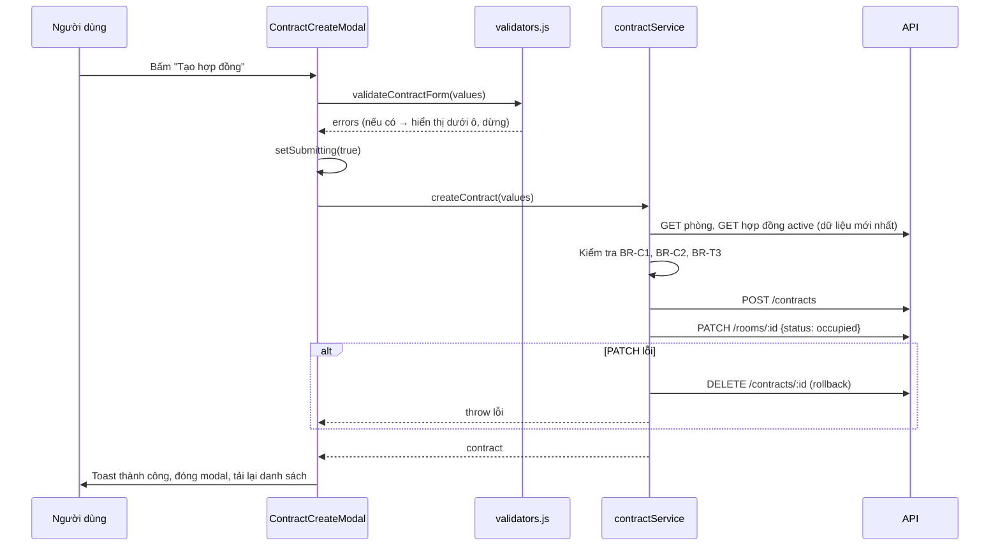

# Hệ thống quản lý phòng trọ — Tài liệu phân tích, thiết kế và triển khai

> **Công nghệ:** React · React-Bootstrap · React Router · Axios · json-server
> **Loại dự án:** Assignment môn học (scope đơn giản, 1 vai trò Chủ nhà)
> **Dữ liệu mẫu:** `db.json` (đi kèm tài liệu này)

---

## Mục lục

1. [Tổng quan](#1-tổng-quan)
2. [Phạm vi dự án](#2-phạm-vi-dự-án)
3. [Phân tích yêu cầu](#3-phân-tích-yêu-cầu)
4. [Quy tắc nghiệp vụ](#4-quy-tắc-nghiệp-vụ)
5. [Thiết kế dữ liệu](#5-thiết-kế-dữ-liệu)
6. [Thiết kế kiến trúc](#6-thiết-kế-kiến-trúc)
7. [Thiết kế API (json-server)](#7-thiết-kế-api-json-server)
8. [Ma trận validate](#8-ma-trận-validate)
9. [Thiết kế giao diện](#9-thiết-kế-giao-diện)
10. [Kế hoạch triển khai từng bước](#10-kế-hoạch-triển-khai-từng-bước)
11. [Xử lý lỗi và các trường hợp biên](#11-xử-lý-lỗi-và-các-trường-hợp-biên)
12. [Kiểm thử](#12-kiểm-thử)
13. [Checklist hoàn thiện và nộp bài](#13-checklist-hoàn-thiện-và-nộp-bài)
14. [Hạn chế và hướng mở rộng](#14-hạn-chế-và-hướng-mở-rộng)
15. [Phụ lục: số liệu kỳ vọng từ dữ liệu mẫu](#15-phụ-lục-số-liệu-kỳ-vọng-từ-dữ-liệu-mẫu)

---

## 1. Tổng quan

### 1.1. Bài toán

Chủ nhà trọ thường ghi chép phòng, người thuê, hợp đồng và tiền thu hằng tháng bằng sổ tay hoặc Excel. Cách này dễ sai sót: quên ai chưa đóng tiền, tính sai tiền điện nước, không biết hợp đồng nào sắp hết hạn, một phòng bị cho thuê trùng.

### 1.2. Mục tiêu

Xây dựng web app giúp chủ nhà:

- Quản lý **phòng** và tình trạng từng phòng (trống / đang thuê / đang sửa).
- Quản lý **người thuê**.
- Quản lý **hợp đồng** (tạo, gia hạn/chỉnh sửa, kết thúc) với trạng thái phòng tự động đồng bộ.
- Lập **hóa đơn hằng tháng** có tính tiền tự động, theo dõi đã/chưa thanh toán, quá hạn.
- Xem **dashboard** tổng quan: công suất phòng, doanh thu, công nợ, hợp đồng sắp hết hạn.

### 1.3. Mục tiêu học tập (liên quan đến môn học)

| Kỹ năng | Thể hiện trong dự án |
|---|---|
| Component và props/state | Bảng, modal, form, badge dùng lại nhiều trang |
| Hooks | `useState`, `useEffect`, `useMemo`, `useCallback`, custom hook |
| Routing | React Router, route bảo vệ (đăng nhập) |
| Gọi API | Axios, interceptor, xử lý lỗi |
| Form và validate | Validate theo trường, theo nghiệp vụ |
| UI framework | React-Bootstrap |
| Tư duy kiến trúc | Tách tầng UI / service / API |

---

## 2. Phạm vi dự án

### 2.1. Trong phạm vi

- Đăng nhập admin đơn giản (so khớp với `users` trong json-server).
- CRUD phòng, CRUD người thuê (có ràng buộc xóa).
- Tạo / sửa hạn chế / kết thúc hợp đồng.
- Tạo / sửa / xóa (khi chưa thanh toán) / thanh toán hóa đơn.
- Tìm kiếm, lọc, phân trang phía client.
- Dashboard thống kê cơ bản.

### 2.2. Ngoài phạm vi

Thanh toán online, gửi SMS/email, upload ảnh/scan giấy tờ, phân quyền nhiều vai trò, đăng nhập cho người thuê, xuất PDF/Excel, đa nhà trọ, đa ngôn ngữ, mã hóa mật khẩu thật (cần backend).

### 2.3. Giả định

1. Một chủ nhà quản lý một dãy trọ.
2. Tiền tệ là VNĐ, số nguyên (không có phần thập phân).
3. Một người thuê chỉ có **một hợp đồng hiệu lực** tại một thời điểm.
4. Một hợp đồng gắn **một phòng** và **một người thuê đại diện**.
5. Điện nước tính theo số đồng hồ, **mỗi hóa đơn lưu đơn giá riêng** (để giá thay đổi không làm sai hóa đơn cũ).
6. Ngày lưu dạng chuỗi `YYYY-MM-DD`, tháng lưu dạng `YYYY-MM`.

---

## 3. Phân tích yêu cầu

### 3.1. Tác nhân

| Tác nhân | Mô tả | Quyền |
|---|---|---|
| **Chủ nhà (Admin)** | Người duy nhất dùng hệ thống | Toàn quyền sau khi đăng nhập |
| **json-server** | Hệ thống phụ (giả lập backend) | Lưu trữ, cung cấp REST |

### 3.2. Danh sách use case

| Mã | Use case | Mô tả ngắn |
|---|---|---|
| UC01 | Đăng nhập / Đăng xuất | Xác thực admin |
| UC02 | Xem dashboard | Thống kê tổng quan |
| UC03 | Quản lý phòng | Xem, tìm, lọc, thêm, sửa, xóa |
| UC04 | Quản lý người thuê | Xem, tìm, thêm, sửa, xóa |
| UC05 | Tạo hợp đồng | Chọn phòng trống + người thuê, nhập ngày, tiền cọc |
| UC06 | Sửa hợp đồng | Gia hạn/rút ngắn ngày kết thúc, chỉnh tiền cọc |
| UC07 | Kết thúc hợp đồng | Trả phòng về trạng thái trống |
| UC08 | Lập hóa đơn | Nhập chỉ số điện nước, phí khác; hệ thống tính tổng |
| UC09 | Sửa / xóa hóa đơn | Chỉ khi chưa thanh toán |
| UC10 | Thanh toán hóa đơn | Đánh dấu đã thanh toán + ngày thanh toán |

### 3.3. Yêu cầu chức năng (FR)

| Mã | Yêu cầu |
|---|---|
| FR-01 | Chỉ người đã đăng nhập mới vào được các trang quản lý |
| FR-02 | Danh sách phòng có tìm theo tên, lọc theo trạng thái, lọc theo tầng, phân trang |
| FR-03 | Thêm/sửa phòng bằng modal, validate đầy đủ |
| FR-04 | Không xóa phòng có hợp đồng (đang hiệu lực hoặc đã có lịch sử) |
| FR-05 | Danh sách người thuê có tìm theo tên/SĐT/CCCD (không phân biệt hoa thường, dấu) |
| FR-06 | Không trùng SĐT, không trùng CCCD |
| FR-07 | Tạo hợp đồng chỉ với phòng trống và người thuê chưa có hợp đồng hiệu lực; phòng tự chuyển "Đang thuê" |
| FR-08 | Kết thúc hợp đồng đưa phòng về "Trống"; chặn nếu còn hóa đơn chưa thanh toán |
| FR-09 | Hiển thị trạng thái hợp đồng suy ra: hiệu lực / sắp hết hạn (≤ 30 ngày) / hết hạn chưa thanh lý / đã kết thúc |
| FR-10 | Lập hóa đơn tự tính tiền, tự lấy chỉ số cũ từ hóa đơn trước |
| FR-11 | Mỗi phòng chỉ có một hóa đơn mỗi tháng |
| FR-12 | Hóa đơn chưa thanh toán và quá `dueDate` hiển thị "Quá hạn" (tính khi hiển thị, không lưu) |
| FR-13 | Đánh dấu thanh toán, lưu `paidDate` |
| FR-14 | Dashboard hiển thị: tổng phòng theo trạng thái, tỷ lệ lấp đầy, doanh thu tháng, công nợ, số hóa đơn quá hạn, hợp đồng sắp hết hạn |
| FR-15 | Mọi thao tác thành công/thất bại đều có thông báo rõ ràng |

### 3.4. Yêu cầu phi chức năng (NFR)

| Mã | Yêu cầu |
|---|---|
| NFR-01 | Giao diện responsive (≥ 360px), bảng cuộn ngang trên mobile |
| NFR-02 | Mọi trang có 4 trạng thái rõ ràng: đang tải / có dữ liệu / rỗng / lỗi |
| NFR-03 | Chống bấm đúp: nút submit bị khóa khi đang gửi |
| NFR-04 | Hành động nguy hiểm (xóa, kết thúc hợp đồng, thanh toán) phải qua modal xác nhận |
| NFR-05 | Thông báo bằng tiếng Việt, thống nhất giọng văn |
| NFR-06 | Định dạng thống nhất: tiền `2.500.000 ₫`, ngày `DD/MM/YYYY`, tháng `MM/YYYY` |
| NFR-07 | Code tách tầng, không viết logic nghiệp vụ trực tiếp trong JSX |

---

## 4. Quy tắc nghiệp vụ

> Các quy tắc này là **nguồn sự thật duy nhất**. Tầng service hiện thực chúng, tầng UI chỉ hiển thị kết quả (ví dụ: ẩn/vô hiệu hóa nút để người dùng ít vướng, nhưng service vẫn kiểm tra lại).

### 4.1. Phòng

| Mã | Quy tắc |
|---|---|
| BR-R1 | Tên phòng là duy nhất (không phân biệt hoa thường, bỏ khoảng trắng đầu/cuối) |
| BR-R2 | Trạng thái `occupied` **chỉ** được đặt bởi hệ thống khi tạo hợp đồng; người dùng không chọn tay |
| BR-R3 | Phòng đang `occupied` không được đổi trạng thái bằng tay (phải kết thúc hợp đồng) |
| BR-R4 | Chỉ chuyển qua lại thủ công giữa `available` ↔ `maintenance` |
| BR-R5 | Không xóa phòng có hợp đồng hiệu lực; không xóa phòng đã có lịch sử hợp đồng (để giữ toàn vẹn dữ liệu, gợi ý chuyển sang "Đang sửa") |

### 4.2. Người thuê

| Mã | Quy tắc |
|---|---|
| BR-T1 | SĐT và CCCD là duy nhất |
| BR-T2 | Không xóa người thuê có hợp đồng hiệu lực hoặc đã có lịch sử hợp đồng |
| BR-T3 | Một người thuê chỉ có tối đa 1 hợp đồng hiệu lực |

### 4.3. Hợp đồng

| Mã | Quy tắc |
|---|---|
| BR-C1 | Chỉ tạo hợp đồng cho phòng `available` (kiểm tra lại dữ liệu mới nhất từ server) |
| BR-C2 | Một phòng chỉ có 1 hợp đồng `active` tại một thời điểm |
| BR-C3 | `endDate` ≥ `startDate` + 30 ngày |
| BR-C4 | `startDate` không sớm hơn hôm nay 30 ngày, không muộn hơn hôm nay 90 ngày (khi tạo mới) |
| BR-C5 | Tiền cọc: 0 ≤ deposit ≤ 3 × giá phòng; mặc định bằng 1 × giá phòng |
| BR-C6 | Tạo hợp đồng thành công ⇒ phòng chuyển `occupied` |
| BR-C7 | Kết thúc hợp đồng ⇒ hợp đồng `ended` (lưu `endedDate`), phòng chuyển `available` |
| BR-C8 | Chỉ kết thúc được hợp đồng `active`; chặn nếu còn hóa đơn `unpaid` |
| BR-C9 | Hợp đồng không bị xóa (chỉ kết thúc) để giữ lịch sử |
| BR-C10 | Chỉ sửa được hợp đồng `active`, và chỉ sửa `endDate`, `deposit`. Không đổi phòng/người thuê/ngày bắt đầu |
| BR-C11 | Nếu một bước ghi dữ liệu thất bại, phải **hoàn tác** bước trước (json-server không có transaction) |

### 4.4. Hóa đơn

| Mã | Quy tắc |
|---|---|
| BR-I1 | Chỉ lập hóa đơn cho hợp đồng `active` |
| BR-I2 | Tháng hóa đơn nằm trong khoảng `[tháng bắt đầu HĐ, min(tháng kết thúc HĐ, tháng hiện tại)]` |
| BR-I3 | Mỗi phòng chỉ có 1 hóa đơn mỗi tháng |
| BR-I4 | Không lập chèn tháng cũ hơn hóa đơn gần nhất của hợp đồng (để chỉ số điện nước liên tục) |
| BR-I5 | Chỉ số cũ = chỉ số mới của hóa đơn gần nhất (tự động, khóa không cho sửa). Hóa đơn đầu tiên của hợp đồng cho nhập tay chỉ số cũ |
| BR-I6 | Chỉ số mới ≥ chỉ số cũ (điện và nước) |
| BR-I7 | `roomFee` lấy từ giá phòng tại thời điểm lập (snapshot) |
| BR-I8 | `total = roomFee + (electricNew − electricOld) × electricPrice + (waterNew − waterOld) × waterPrice + otherFee`. **Service luôn tự tính lại**, không tin giá trị từ form |
| BR-I9 | Trạng thái hiển thị: `paid` nếu đã thanh toán; `overdue` nếu `unpaid` và `dueDate` < hôm nay; còn lại `unpaid` |
| BR-I10 | Chỉ sửa/xóa hóa đơn `unpaid`. Hóa đơn `paid` bị khóa |
| BR-I11 | Thanh toán: `paidDate` nằm trong `[createdDate, hôm nay]` |
| BR-I12 | Cảnh báo mềm (có xác nhận, không chặn): điện > 500 kWh hoặc nước > 50 m³ trong một kỳ |

### 4.5. Máy trạng thái







---

## 5. Thiết kế dữ liệu

### 5.1. ERD



### 5.2. Từ điển dữ liệu

**rooms**

| Trường | Kiểu | Bắt buộc | Ghi chú |
|---|---|---|---|
| id | number | auto | json-server tự sinh |
| name | string | ✔ | Duy nhất, VD `P101` |
| floor | integer | ✔ | 1–50 |
| area | number | ✔ | m², > 0 |
| price | integer | ✔ | VNĐ/tháng |
| status | enum | ✔ | `available` · `occupied` · `maintenance` |
| description | string | ✘ | ≤ 200 ký tự |

**tenants**

| Trường | Kiểu | Bắt buộc | Ghi chú |
|---|---|---|---|
| id | number | auto | |
| fullName | string | ✔ | |
| phone | string | ✔ | Lưu **string** để giữ số 0 đầu |
| idCard | string | ✔ | 12 chữ số, lưu **string** |
| hometown | string | ✔ | |

**contracts**

| Trường | Kiểu | Bắt buộc | Ghi chú |
|---|---|---|---|
| id | number | auto | |
| roomId | number | ✔ | FK → rooms |
| tenantId | number | ✔ | FK → tenants |
| startDate | string | ✔ | `YYYY-MM-DD` |
| endDate | string | ✔ | `YYYY-MM-DD` |
| deposit | integer | ✔ | |
| status | enum | ✔ | `active` · `ended` |
| endedDate | string \| null | ✘ | Ngày thanh lý thực tế, thêm khi kết thúc |

**invoices**

| Trường | Kiểu | Bắt buộc | Ghi chú |
|---|---|---|---|
| id | number | auto | |
| contractId, roomId | number | ✔ | FK |
| month | string | ✔ | `YYYY-MM` |
| roomFee | integer | ✔ | Snapshot giá phòng |
| electricOld/New, waterOld/New | integer | ✔ | Chỉ số đồng hồ |
| electricPrice, waterPrice | integer | ✔ | Đơn giá |
| otherFee | integer | ✔ | ≥ 0 (rác, wifi, gửi xe...) |
| total | integer | ✔ | Do service tính |
| createdDate | string | ✔ | Ngày lập |
| dueDate | string | ✔ | Hạn thanh toán |
| status | enum | ✔ | `unpaid` · `paid` |
| paidDate | string \| null | ✘ | |

**users:** `id`, `username`, `password`, `fullName` (mật khẩu plain text chỉ dùng cho bài học).

### 5.3. Giá trị suy ra (không lưu DB)

| Giá trị | Cách tính |
|---|---|
| Trạng thái hóa đơn hiển thị | `paid` / `overdue` (`unpaid` và `dueDate < today`) / `unpaid` |
| Trạng thái hợp đồng hiển thị | `ended` / `expired` (`endDate < today`) / `expiring` (còn ≤ 30 ngày) / `active` |
| Doanh thu tháng | Tổng `total` của hóa đơn `paid` có `paidDate` thuộc tháng đó (tính theo ngày thu tiền) |
| Công nợ | Tổng `total` của hóa đơn `unpaid` |
| Tỷ lệ lấp đầy | `occupied / tổng phòng × 100` |

### 5.4. Lưu ý về ID

json-server sinh `id` kiểu **number**. Giá trị lấy từ `<Form.Select>` luôn là **string**. Nếu so sánh `contract.roomId === selectedRoomId` sẽ sai (`1 !== "1"`). **Quy ước:** mọi giá trị id lấy từ form phải qua `Number()` trước khi so sánh hoặc gửi lên API.

---

## 6. Thiết kế kiến trúc

### 6.1. Kiến trúc phân tầng



**Nguyên tắc bắt buộc để code đồng bộ:**

1. **Page không gọi API ghi trực tiếp.** Mọi thao tác tạo/sửa/xóa đi qua `services/`.
2. **Page chỉ gọi API đọc** (danh sách) thông qua module `api/` hoặc service.
3. **Hai lớp validate:**
   - *Validate hình thức* (đồng bộ, trong `utils/validators.js`): bắt buộc, định dạng, khoảng giá trị, trùng lặp so với danh sách đang có. Chạy ngay khi gõ/blur/submit để hiển thị lỗi dưới từng ô.
   - *Validate nghiệp vụ* (bất đồng bộ, trong `services/`): **tải lại dữ liệu mới nhất từ server** rồi kiểm tra (phòng còn trống không, có hóa đơn chưa thanh toán không...). Lỗi ném ra `AppError`, UI hiển thị bằng `Alert` trong modal hoặc toast.
4. **Công thức tính tiền chỉ có một nơi:** `utils/calcInvoice.js`. Form dùng nó để xem trước, service dùng nó để lưu.
5. **Trạng thái suy ra chỉ có một nơi:** `utils/status.js`. Mọi trang dùng chung.
6. **Hằng số chỉ có một nơi:** `utils/constants.js` (enum trạng thái, nhãn tiếng Việt, đơn giá mặc định, kích thước trang).

### 6.2. Cấu trúc thư mục

```
rental-manager/
├── db.json                  # dữ liệu hiện hành
├── db.sample.json           # bản sao dữ liệu mẫu để khôi phục khi test
├── .env                     # PORT=3000; REACT_APP_API_URL=http://localhost:9999 (Create React App)
├── package.json
└── src/
    ├── api/
    │   ├── axiosClient.js
    │   ├── roomApi.js
    │   ├── tenantApi.js
    │   ├── contractApi.js
    │   ├── invoiceApi.js
    │   └── authApi.js
    ├── services/
    │   ├── roomService.js
    │   ├── tenantService.js
    │   ├── contractService.js
    │   ├── invoiceService.js
    │   ├── authService.js
    │   └── dashboardService.js
    ├── utils/
    │   ├── constants.js
    │   ├── AppError.js
    │   ├── date.js
    │   ├── format.js
    │   ├── text.js              # normalize tìm kiếm không dấu
    │   ├── status.js
    │   ├── calcInvoice.js
    │   └── validators.js
    ├── hooks/
    │   ├── useFetch.js
    │   └── usePagination.js
    ├── context/
    │   ├── AuthContext.jsx
    │   └── ToastContext.jsx
    ├── components/
    │   ├── layout/ (AppLayout.jsx, AppNavbar.jsx, ProtectedRoute.jsx)
    │   └── common/ (PageHeader, StatusBadge, ConfirmModal, DataState,
    │                Pagination, FormField, MoneyText)
    ├── pages/
    │   ├── LoginPage.jsx
    │   ├── DashboardPage.jsx
    │   ├── rooms/      (RoomsPage.jsx, RoomFormModal.jsx)
    │   ├── tenants/    (TenantsPage.jsx, TenantFormModal.jsx)
    │   ├── contracts/  (ContractsPage.jsx, ContractCreateModal.jsx, ContractEditModal.jsx)
    │   └── invoices/   (InvoicesPage.jsx, InvoiceFormModal.jsx, PayInvoiceModal.jsx)
    ├── App.js               # Create React App entry component
    └── index.js             # Create React App bootstrap
```

### 6.3. Luồng dữ liệu của một thao tác ghi (ví dụ: tạo hợp đồng)



---

## 7. Thiết kế API (json-server)

### 7.1. Phiên bản và chạy server

Dùng **json-server** (ổn định, hỗ trợ `_expand`, `_embed`, `q`, `_sort`, `_page`). Bản 1.x (beta) đổi cú pháp nên không dùng chung tài liệu này.

```bash
npm install axios react-bootstrap bootstrap react-router-dom
npm install -D json-server
```

Với dự án dùng Create React App, giữ script `start` hiện có và thêm script chạy API giả lập:

```json
{
  "scripts": {
    "start": "react-scripts start",
    "server": "json-server --watch db.json --port 9999"
  }
}
```

Chạy hai terminal: `npm run server` và `npm start`. Ứng dụng React chạy tại `http://localhost:3000`, API chạy tại `http://localhost:9999`.

### 7.2. Endpoint sử dụng

| Mục đích | Request |
|---|---|
| Danh sách phòng | `GET /rooms` |
| Một phòng | `GET /rooms/:id` |
| Thêm / sửa / sửa một phần / xóa phòng | `POST /rooms` · `PUT /rooms/:id` · `PATCH /rooms/:id` · `DELETE /rooms/:id` |
| Hợp đồng kèm phòng và người thuê | `GET /contracts?_expand=room&_expand=tenant` |
| Hợp đồng của một phòng | `GET /contracts?roomId=1` |
| Hợp đồng đang hiệu lực | `GET /contracts?status=active` |
| Hóa đơn của một hợp đồng | `GET /invoices?contractId=1` |
| Hóa đơn của phòng theo tháng | `GET /invoices?roomId=1&month=2026-11` |
| Hóa đơn chưa thanh toán của hợp đồng | `GET /invoices?contractId=1&status=unpaid` |
| Thanh toán | `PATCH /invoices/:id` body `{ "status": "paid", "paidDate": "2026-11-09" }` |
| Đăng nhập | `GET /users?username=admin&password=123456` (mảng rỗng = sai) |

### 7.3. Quyết định thiết kế: lọc phía client

Quy mô nhỏ (vài chục phòng, vài trăm hóa đơn) nên **tải toàn bộ danh sách rồi lọc, tìm, sắp xếp, phân trang ở client** bằng `useMemo`. Lý do: tìm không dấu và tìm nhiều trường khó làm bằng `q=` của json-server; ít request hơn nên ít lỗi hơn. Chỉ dùng query server cho các kiểm tra nghiệp vụ trong service (cần dữ liệu mới nhất).

---

## 8. Ma trận validate

> Cột **Nơi kiểm tra**: `F` = validate hình thức ở form (hiển thị lỗi ngay dưới ô), `S` = kiểm tra nghiệp vụ trong service (hiển thị bằng Alert/toast).
> Mọi chuỗi nhập đều `trim()` và gộp khoảng trắng liên tiếp thành một trước khi kiểm tra và lưu.

### 8.1. Phòng

| Mã | Trường | Quy tắc | Thông báo | Nơi |
|---|---|---|---|---|
| RM-01 | name | Bắt buộc | Vui lòng nhập tên phòng | F |
| RM-02 | name | 2–20 ký tự, chỉ chữ, số, khoảng trắng, dấu `-` | Tên phòng gồm 2–20 ký tự (chữ, số, khoảng trắng, dấu -) | F |
| RM-03 | name | Không trùng phòng khác (không phân biệt hoa thường) | Tên phòng đã tồn tại | F + S |
| RM-04 | floor | Bắt buộc, số nguyên 1–50 | Tầng phải là số nguyên từ 1 đến 50 | F |
| RM-05 | area | Bắt buộc, số > 0 và ≤ 200 | Diện tích phải lớn hơn 0 và không quá 200 m² | F |
| RM-06 | price | Bắt buộc, số nguyên 100.000–100.000.000 | Giá thuê phải từ 100.000 đến 100.000.000 ₫ | F |
| RM-07 | status | Chỉ `available` / `maintenance` khi thêm mới | Trạng thái không hợp lệ | F |
| RM-08 | description | ≤ 200 ký tự | Mô tả tối đa 200 ký tự | F |
| RM-09 | status | Phòng `occupied` không đổi trạng thái tay (select bị khóa, service chặn lại) | Phòng đang có người thuê. Hãy kết thúc hợp đồng trước khi đổi trạng thái | S |
| RM-10 | status | Không được đặt `occupied` bằng tay | Trạng thái "Đang thuê" chỉ được đặt khi tạo hợp đồng | S |
| RM-11 | xóa | Có hợp đồng `active` | Không thể xóa: phòng đang có hợp đồng hiệu lực | S |
| RM-12 | xóa | Có lịch sử hợp đồng | Không thể xóa: phòng đã có lịch sử hợp đồng. Bạn có thể chuyển phòng sang "Đang sửa" | S |

### 8.2. Người thuê

| Mã | Trường | Quy tắc | Thông báo | Nơi |
|---|---|---|---|---|
| TN-01 | fullName | Bắt buộc | Vui lòng nhập họ tên | F |
| TN-02 | fullName | 2–50 ký tự, chỉ chữ (có dấu) và khoảng trắng | Họ tên chỉ gồm chữ cái, từ 2 đến 50 ký tự | F |
| TN-03 | phone | Bắt buộc | Vui lòng nhập số điện thoại | F |
| TN-04 | phone | Regex `^0[35789]\d{8}$` | Số điện thoại phải gồm 10 chữ số, bắt đầu bằng 03, 05, 07, 08 hoặc 09 | F |
| TN-05 | phone | Không trùng người khác | Số điện thoại đã được dùng bởi người thuê khác | F + S |
| TN-06 | idCard | Bắt buộc, đúng 12 chữ số | CCCD phải gồm đúng 12 chữ số | F |
| TN-07 | idCard | Không trùng người khác | CCCD đã tồn tại | F + S |
| TN-08 | hometown | Bắt buộc, ≤ 100 ký tự | Vui lòng nhập quê quán (tối đa 100 ký tự) | F |
| TN-09 | xóa | Có hợp đồng `active` | Không thể xóa: người thuê đang có hợp đồng hiệu lực | S |
| TN-10 | xóa | Có lịch sử hợp đồng | Không thể xóa: người thuê đã có lịch sử hợp đồng | S |

### 8.3. Hợp đồng

| Mã | Trường | Quy tắc | Thông báo | Nơi |
|---|---|---|---|---|
| CT-01 | roomId | Bắt buộc chọn | Vui lòng chọn phòng | F |
| CT-02 | roomId | Phòng phải còn `available` (tải lại từ server) | Phòng này không còn trống. Vui lòng chọn phòng khác | S |
| CT-03 | roomId | Phòng không có hợp đồng `active` khác | Phòng này đang có hợp đồng hiệu lực | S |
| CT-04 | tenantId | Bắt buộc chọn | Vui lòng chọn người thuê | F |
| CT-05 | tenantId | Người thuê không có hợp đồng `active` | Người thuê này đang có hợp đồng hiệu lực | S |
| CT-06 | startDate | Bắt buộc, ngày hợp lệ | Vui lòng chọn ngày bắt đầu | F |
| CT-07 | startDate | Trong khoảng [hôm nay − 30 ngày, hôm nay + 90 ngày] | Ngày bắt đầu chỉ được trong khoảng 30 ngày trước đến 90 ngày sau hôm nay | F |
| CT-08 | endDate | Bắt buộc, ngày hợp lệ | Vui lòng chọn ngày kết thúc | F |
| CT-09 | endDate | ≥ startDate + 30 ngày | Hợp đồng phải kéo dài tối thiểu 30 ngày | F |
| CT-10 | deposit | Bắt buộc, số nguyên ≥ 0 | Tiền cọc phải là số nguyên không âm | F |
| CT-11 | deposit | ≤ 3 × giá phòng | Tiền cọc không được vượt quá 3 tháng tiền phòng | F |
| CT-12 | kết thúc | Hợp đồng phải `active` | Hợp đồng đã được kết thúc trước đó | S |
| CT-13 | kết thúc | Không còn hóa đơn `unpaid` | Còn N hóa đơn chưa thanh toán. Vui lòng thu tiền trước khi kết thúc hợp đồng | S |
| CT-14 | sửa | Chỉ sửa hợp đồng `active` | Chỉ có thể sửa hợp đồng đang hiệu lực | S |
| CT-15 | sửa endDate | ≥ startDate + 30 ngày, và không sớm hơn tháng của hóa đơn gần nhất | Ngày kết thúc không được sớm hơn kỳ hóa đơn đã lập (MM/YYYY) | F + S |

### 8.4. Hóa đơn

| Mã | Trường | Quy tắc | Thông báo | Nơi |
|---|---|---|---|---|
| IV-01 | contractId | Bắt buộc chọn, hợp đồng phải `active` | Vui lòng chọn hợp đồng đang hiệu lực | F + S |
| IV-02 | month | Bắt buộc, định dạng `YYYY-MM` | Vui lòng chọn tháng | F |
| IV-03 | month | Trong `[tháng bắt đầu HĐ, min(tháng kết thúc HĐ, tháng hiện tại)]` | Tháng lập hóa đơn phải nằm trong thời hạn hợp đồng và không ở tương lai | F |
| IV-04 | month | Phòng chưa có hóa đơn tháng này | Phòng X đã có hóa đơn tháng MM/YYYY | S |
| IV-05 | month | Lớn hơn tháng của hóa đơn gần nhất của hợp đồng | Chỉ được lập hóa đơn cho tháng sau MM/YYYY | S |
| IV-06 | electricOld | Hóa đơn đầu: số nguyên ≥ 0 nhập tay. Các hóa đơn sau: tự điền, khóa | Chỉ số điện cũ phải là số nguyên không âm | F |
| IV-07 | electricNew | Bắt buộc, số nguyên ≥ electricOld | Chỉ số điện mới phải lớn hơn hoặc bằng chỉ số cũ | F |
| IV-08 | waterOld | Như IV-06 | Chỉ số nước cũ phải là số nguyên không âm | F |
| IV-09 | waterNew | Như IV-07 | Chỉ số nước mới phải lớn hơn hoặc bằng chỉ số cũ | F |
| IV-10 | electricPrice | Số nguyên 1.000–10.000 | Đơn giá điện phải từ 1.000 đến 10.000 ₫/kWh | F |
| IV-11 | waterPrice | Số nguyên 5.000–100.000 | Đơn giá nước phải từ 5.000 đến 100.000 ₫/m³ | F |
| IV-12 | otherFee | Số nguyên 0–10.000.000 | Phí khác phải từ 0 đến 10.000.000 ₫ | F |
| IV-13 | dueDate | Bắt buộc, ≥ createdDate | Hạn thanh toán không được trước ngày lập hóa đơn | F |
| IV-14 | cảnh báo | Điện > 500 kWh hoặc nước > 50 m³ | Mức tiêu thụ bất thường (X kWh / Y m³). Bạn có chắc đã nhập đúng? (nút Xác nhận) | F (mềm) |
| IV-15 | sửa/xóa | Chỉ hóa đơn `unpaid` | Hóa đơn đã thanh toán không thể sửa hoặc xóa | S |
| IV-16 | thanh toán | Hóa đơn phải `unpaid` | Hóa đơn này đã được thanh toán | S |
| IV-17 | paidDate | Bắt buộc, trong [createdDate, hôm nay] | Ngày thanh toán phải từ ngày lập hóa đơn đến hôm nay | F |

### 8.5. Đăng nhập

| Mã | Quy tắc | Thông báo | Nơi |
|---|---|---|---|
| AU-01 | Bắt buộc username, password | Vui lòng nhập tên đăng nhập / mật khẩu | F |
| AU-02 | Sai thông tin | Tên đăng nhập hoặc mật khẩu không đúng | S |
| AU-03 | Chưa đăng nhập vào trang quản lý | Chuyển về `/login`, nhớ trang đang vào | Route |
| AU-04 | Đã đăng nhập vào `/login` | Chuyển về `/` | Route |
| AU-05 | Đăng xuất | Xóa phiên, về `/login` | Route |

### 8.6. Lỗi hệ thống (chung)

| Mã | Tình huống | Thông báo |
|---|---|---|
| SYS-01 | Không kết nối được server | Không kết nối được máy chủ. Hãy kiểm tra json-server đã chạy ở cổng 9999 chưa |
| SYS-02 | HTTP 404 | Không tìm thấy dữ liệu (có thể đã bị xóa ở nơi khác) |
| SYS-03 | HTTP 5xx / lỗi khác | Đã xảy ra lỗi, vui lòng thử lại |

---

## 9. Thiết kế giao diện

### 9.1. Quy ước chung (để toàn app đồng bộ)

**Layout:** `Navbar` cố định trên cùng (logo, các mục menu, tên admin, nút Đăng xuất) + `Container` nội dung. Mục menu đang mở được tô `active`.

**Mẫu trang danh sách (dùng cho Rooms, Tenants, Contracts, Invoices):**

```
┌────────────────────────────────────────────────────┐
│ PageHeader:  Tiêu đề trang              [+ Thêm]   │
├────────────────────────────────────────────────────┤
│ Thanh lọc: [Tìm kiếm...] [Lọc 1 ▾] [Lọc 2 ▾] [Xóa lọc] │
├────────────────────────────────────────────────────┤
│ DataState: loading → Spinner | error → Alert + [Thử lại] │
│            empty → "Không có dữ liệu" | ok → Table  │
├────────────────────────────────────────────────────┤
│ Hiển thị 1–10 / 37                     Pagination   │
└────────────────────────────────────────────────────┘
```

**Màu badge thống nhất (`StatusBadge`):**

| Đối tượng | Giá trị | Nhãn | Màu (bg) |
|---|---|---|---|
| Phòng | available | Trống | success |
| Phòng | occupied | Đang thuê | primary |
| Phòng | maintenance | Đang sửa | warning |
| Hợp đồng | active | Hiệu lực | success |
| Hợp đồng | expiring | Sắp hết hạn | warning |
| Hợp đồng | expired | Quá hạn thanh lý | danger |
| Hợp đồng | ended | Đã kết thúc | secondary |
| Hóa đơn | paid | Đã thanh toán | success |
| Hóa đơn | unpaid | Chưa thanh toán | warning |
| Hóa đơn | overdue | Quá hạn | danger |

**Mẫu modal form (dùng cho mọi form):**

- Tiêu đề rõ ràng ("Thêm phòng" / "Sửa phòng P101").
- Mỗi trường: `Form.Label` (dấu `*` đỏ nếu bắt buộc) + control + `Form.Control.Feedback type="invalid"`.
- Lỗi hiển thị khi: bấm submit, hoặc rời ô (`onBlur`, trường đã `touched`) và sau đó sửa lại thì lỗi cập nhật ngay.
- Lỗi nghiệp vụ từ service: `Alert variant="danger"` ở đầu phần thân modal.
- Footer: `[Hủy]` và `[Lưu]`. Khi đang gửi: nút Lưu hiện `Spinner` + disabled, nút Hủy disabled, không đóng được modal bằng nền/phím Esc (`backdrop="static"`, `keyboard={!submitting}`).
- Thành công: đóng modal, hiện toast xanh, danh sách tải lại.

**Thông báo (Toast):** góc trên phải, tự ẩn sau 3 giây. Xanh = thành công, đỏ = lỗi.

**Định dạng hiển thị:** tiền `2.500.000 ₫`, ngày `09/11/2026`, tháng `11/2026`, số căn phải trong bảng, tiền căn phải.

**Bàn phím/trợ năng cơ bản:** `Form.Label` gắn `htmlFor`, tự focus vào ô đầu tiên khi mở modal, Enter để submit form.

### 9.2. Từng trang

#### `/login`

- Card giữa màn hình: Tên đăng nhập, Mật khẩu, nút Đăng nhập.
- Validate AU-01, hiển thị AU-02 bằng Alert.
- Thành công: lưu phiên (xem 10.4), chuyển về trang đã định vào hoặc `/`.

#### `/` Dashboard

Hàng 1 — 4 thẻ `Card`: **Tổng phòng**, **Đang thuê**, **Phòng trống**, **Đang sửa** (kèm tỷ lệ lấp đầy).
Hàng 2 — 3 thẻ: **Doanh thu tháng này**, **Công nợ (chưa thu)**, **Hóa đơn quá hạn**.
Hàng 3 — 2 bảng nhỏ: **Hợp đồng sắp hết hạn (≤ 30 ngày)** và **Hóa đơn quá hạn** (mỗi bảng tối đa 5 dòng, có link sang trang đầy đủ).

#### `/rooms`

- Cột: Tên phòng · Tầng · Diện tích · Giá thuê · Trạng thái · Người đang thuê (nếu có) · Thao tác (Sửa, Xóa).
- Lọc: tìm theo tên, trạng thái, tầng.
- Modal thêm/sửa: name, floor, area, price, status (chỉ hai lựa chọn Trống/Đang sửa; nếu phòng đang thuê thì hiển thị badge "Đang thuê" và khóa trường), description.
- Xóa: `ConfirmModal`; nếu service chặn thì hiển thị lý do (RM-11/RM-12).

#### `/tenants`

- Cột: Họ tên · SĐT · CCCD · Quê quán · Phòng đang thuê (nếu có) · Thao tác.
- Tìm theo tên/SĐT/CCCD (không dấu, không phân biệt hoa thường).
- Modal thêm/sửa, ConfirmModal xóa (TN-09/TN-10).

#### `/contracts`

- Cột: Phòng · Người thuê · SĐT · Bắt đầu · Kết thúc · Tiền cọc · Trạng thái · Thao tác (Sửa, Kết thúc).
- Lọc: tab trạng thái (Tất cả / Hiệu lực / Sắp hết hạn / Quá hạn thanh lý / Đã kết thúc) + ô tìm theo tên phòng/người thuê.
- Hợp đồng `ended`: ẩn nút Sửa/Kết thúc.
- **Modal tạo hợp đồng:** Select phòng (chỉ phòng `available`, hiển thị `P103 — 2.800.000 ₫`), Select người thuê (chỉ người chưa có hợp đồng hiệu lực), ngày bắt đầu, ngày kết thúc (gợi ý mặc định = bắt đầu + 12 tháng), tiền cọc (tự điền bằng giá phòng khi chọn phòng, vẫn sửa được). Nếu không có phòng trống hoặc không có người thuê hợp lệ: hiển thị `Alert info` hướng dẫn ("Chưa có phòng trống", "Hãy thêm người thuê trước").
- **Modal sửa:** phòng, người thuê, ngày bắt đầu hiển thị chỉ đọc; chỉ sửa ngày kết thúc và tiền cọc.
- **Kết thúc:** `ConfirmModal` nêu rõ hệ quả ("Phòng P101 sẽ chuyển về Trống").

#### `/invoices`

- Cột: Tháng · Phòng · Người thuê · Điện (số dùng) · Nước (số dùng) · Phí khác · Tổng tiền · Hạn · Trạng thái · Thao tác (Xem, Sửa, Xóa, Thanh toán).
- Lọc: tháng (`<input type="month">`), trạng thái (Tất cả/Chưa thanh toán/Quá hạn/Đã thanh toán), tìm theo phòng.
- Hàng tổng kết phía trên bảng: số hóa đơn đang lọc, tổng tiền, đã thu, còn nợ.
- **Modal lập hóa đơn:**
  1. Chọn hợp đồng (chỉ `active`, hiển thị `P101 — Nguyễn Văn An`).
  2. Chọn tháng (mặc định tháng hiện tại hoặc tháng sau hóa đơn gần nhất).
  3. Hệ thống tải hóa đơn gần nhất của hợp đồng ⇒ tự điền và khóa chỉ số cũ (hoặc mở khóa nếu là hóa đơn đầu tiên).
  4. Nhập chỉ số mới điện, nước; đơn giá mặc định 3.500 / 20.000 (sửa được); phí khác; hạn thanh toán (mặc định ngày lập + 7).
  5. **Khung xem trước** cập nhật theo thời gian thực: tiền phòng, điện (số dùng × đơn giá), nước, phí khác, **Tổng**.
- **Thanh toán:** modal nhỏ chọn `paidDate` (mặc định hôm nay), hiển thị số tiền, nút "Xác nhận đã thu".
- Hóa đơn `paid`: ẩn Sửa/Xóa/Thanh toán, chỉ còn Xem.

---

## 10. Kế hoạch triển khai từng bước

> Làm **theo đúng thứ tự**: mỗi giai đoạn dùng lại thành phần của giai đoạn trước. Mỗi giai đoạn có **Định nghĩa hoàn thành (DoD)**: chưa đạt DoD thì chưa sang giai đoạn sau.

> **Tiến độ triển khai:** Giai đoạn 0–9 (nền tảng, đăng nhập/điều hướng, CRUD phòng/người thuê/hợp đồng/hóa đơn, Dashboard, rà soát đồng bộ và đóng gói bàn giao) đã được triển khai trên Create React App.

### Giai đoạn 0 — Khởi tạo (≈ 0,5 buổi)

1. Dùng project Create React App hiện có.
2. Cài thư viện (xem 7.1). Với dự án Create React App, thêm `import 'bootstrap/dist/css/bootstrap.min.css'` vào `src/index.js`.
3. Đặt `db.json` ở thư mục gốc, sao thêm một bản `db.sample.json`.
4. Thêm `.env`: `PORT=3000` và `REACT_APP_API_URL=http://localhost:9999`.
5. Tạo cây thư mục như mục 6.2 (file rỗng trước).
6. Chạy `npm run server`, mở `http://localhost:9999/rooms` kiểm tra trả JSON.

**DoD:** app React chạy được, gọi thử `GET /rooms` bằng Axios in ra console.

### Giai đoạn 1 — Nền tảng dùng chung (≈ 1 buổi)

Làm hết giai đoạn này **trước** khi viết bất kỳ trang nào, vì mọi trang dựa vào nó.

**1.1. `utils/constants.js`**

```js
export const ROOM_STATUS = { AVAILABLE: 'available', OCCUPIED: 'occupied', MAINTENANCE: 'maintenance' };
export const CONTRACT_STATUS = { ACTIVE: 'active', ENDED: 'ended' };
export const INVOICE_STATUS = { UNPAID: 'unpaid', PAID: 'paid' };

export const DEFAULT_ELECTRIC_PRICE = 3500;
export const DEFAULT_WATER_PRICE = 20000;
export const DEFAULT_DUE_DAYS = 7;
export const EXPIRING_DAYS = 30;
export const PAGE_SIZE = 10;
```

**1.2. `utils/AppError.js`**: lỗi nghiệp vụ, để UI phân biệt với lỗi hệ thống.

```js
export class AppError extends Error {
  constructor(message) {
    super(message);
    this.name = 'AppError';
  }
}
```

**1.3. `utils/date.js`**: **không dùng `toISOString()` để lấy ngày hôm nay** vì nó trả về giờ UTC, ở Việt Nam (UTC+7) từ 0h–7h sáng sẽ ra ngày hôm qua.

```js
const pad = (n) => String(n).padStart(2, '0');

export const toDateStr = (d) => `${d.getFullYear()}-${pad(d.getMonth() + 1)}-${pad(d.getDate())}`;
export const todayStr = () => toDateStr(new Date());
export const currentMonthStr = () => todayStr().slice(0, 7);

const parts = (s) => s.split('-').map(Number);

export const addDays = (dateStr, days) => {
  const [y, m, d] = parts(dateStr);
  return toDateStr(new Date(y, m - 1, d + days));
};

export const addMonths = (dateStr, months) => {
  const [y, m, d] = parts(dateStr);
  const target = new Date(y, m - 1 + months, 1);
  const lastDay = new Date(target.getFullYear(), target.getMonth() + 1, 0).getDate();
  target.setDate(Math.min(d, lastDay)); // 31/01 + 1 tháng = 28 hoặc 29/02
  return toDateStr(target);
};

export const daysBetween = (a, b) => {
  const utc = (s) => { const [y, m, d] = parts(s); return Date.UTC(y, m - 1, d); };
  return Math.round((utc(b) - utc(a)) / 86400000);
};

export const isValidDateStr = (s) => {
  if (!/^\d{4}-\d{2}-\d{2}$/.test(s || '')) return false;
  const [y, m, d] = parts(s);
  const dt = new Date(y, m - 1, d);
  return dt.getFullYear() === y && dt.getMonth() === m - 1 && dt.getDate() === d;
};

export const formatDate = (s) => (s ? s.split('-').reverse().join('/') : '—');
export const formatMonth = (s) => (s ? s.split('-').reverse().join('/') : '—');
```

**1.4. `utils/format.js` và `utils/text.js`**

```js
// format.js
const vnd = new Intl.NumberFormat('vi-VN', { style: 'currency', currency: 'VND' });
export const formatCurrency = (n) => vnd.format(Number(n) || 0);

// text.js — tìm kiếm không dấu, không phân biệt hoa thường
export const normalize = (s) =>
  String(s ?? '')
    .toLowerCase()
    .normalize('NFD')
    .replace(/[\u0300-\u036f]/g, '')
    .replace(/đ/g, 'd')
    .trim();

export const cleanSpaces = (s) => String(s ?? '').trim().replace(/\s+/g, ' ');
```

**1.5. `utils/calcInvoice.js`**: nơi duy nhất chứa công thức.

```js
const n = (v) => Number(v) || 0;

export function calcInvoice(v) {
  const electricUsed = n(v.electricNew) - n(v.electricOld);
  const waterUsed = n(v.waterNew) - n(v.waterOld);
  const electricAmount = electricUsed * n(v.electricPrice);
  const waterAmount = waterUsed * n(v.waterPrice);
  const total = n(v.roomFee) + electricAmount + waterAmount + n(v.otherFee);
  return { electricUsed, waterUsed, electricAmount, waterAmount, total };
}
```

**1.6. `utils/status.js`**: trạng thái suy ra, dùng chung toàn app.

```js
import { todayStr, daysBetween } from './date';
import { EXPIRING_DAYS } from './constants';

export const getInvoiceStatus = (inv) =>
  inv.status === 'paid' ? 'paid' : inv.dueDate < todayStr() ? 'overdue' : 'unpaid';

export const getContractStatus = (c) => {
  if (c.status === 'ended') return 'ended';
  const today = todayStr();
  if (c.endDate < today) return 'expired';
  if (daysBetween(today, c.endDate) <= EXPIRING_DAYS) return 'expiring';
  return 'active';
};
```

(So sánh chuỗi `YYYY-MM-DD` theo thứ tự chữ cái cho kết quả đúng thứ tự thời gian.)

**1.7. `api/axiosClient.js`**: đổi mọi lỗi sang thông báo tiếng Việt thống nhất (SYS-01…03).

```js
import axios from 'axios';
import { AppError } from '../utils/AppError';

const axiosClient = axios.create({
  baseURL: process.env.REACT_APP_API_URL || 'http://localhost:9999',
  timeout: 8000,
});

axiosClient.interceptors.response.use(
  (res) => res.data,
  (err) => {
    if (!err.response) {
      return Promise.reject(new AppError('Không kết nối được máy chủ. Hãy kiểm tra json-server đã chạy ở cổng 9999 chưa'));
    }
    if (err.response.status === 404) {
      return Promise.reject(new AppError('Không tìm thấy dữ liệu (có thể đã bị xóa ở nơi khác)'));
    }
    return Promise.reject(new AppError('Đã xảy ra lỗi, vui lòng thử lại'));
  }
);

export default axiosClient;
```

**1.8. Các module API** (mỗi resource cùng một khuôn, ví dụ `roomApi.js`):

```js
import axiosClient from './axiosClient';

export const roomApi = {
  getAll: (params) => axiosClient.get('/rooms', { params }),
  getById: (id) => axiosClient.get(`/rooms/${id}`),
  create: (data) => axiosClient.post('/rooms', data),
  update: (id, data) => axiosClient.put(`/rooms/${id}`, data),
  patch: (id, data) => axiosClient.patch(`/rooms/${id}`, data),
  remove: (id) => axiosClient.delete(`/rooms/${id}`),
};
```

Làm tương tự `tenantApi`, `contractApi` (thêm `getAllExpanded = () => get('/contracts', { params: { _expand: ['room', 'tenant'] } })`; Axios mặc định sẽ gửi `_expand[]=room`, nên cấu hình `paramsSerializer: { indexes: null }` hoặc viết tay chuỗi `'/contracts?_expand=room&_expand=tenant'`), `invoiceApi`, `authApi`.

**1.9. Hook và context**

`hooks/useFetch.js`: gom 3 trạng thái `loading / error / data` và hàm `reload`.

```js
import { useState, useEffect, useCallback } from 'react';

export function useFetch(fetcher, deps = []) {
  const [data, setData] = useState(null);
  const [loading, setLoading] = useState(true);
  const [error, setError] = useState(null);

  const load = useCallback(async () => {
    setLoading(true);
    setError(null);
    try {
      setData(await fetcher());
    } catch (e) {
      setError(e.message);
    } finally {
      setLoading(false);
    }
    // eslint-disable-next-line react-hooks/exhaustive-deps
  }, deps);

  useEffect(() => { load(); }, [load]);
  return { data, loading, error, reload: load };
}
```

`hooks/usePagination.js`: nhận danh sách đã lọc, trả `pageItems`, `page`, `setPage`, `totalPages`; **tự về trang 1 khi danh sách đổi do lọc**, và tự lùi trang nếu trang hiện tại vượt quá tổng số trang (ví dụ xóa phần tử cuối của trang cuối).

`context/ToastContext.jsx`: cung cấp `showSuccess(msg)`, `showError(msg)`, render `ToastContainer` của React-Bootstrap.

**1.10. Component dùng chung:** `PageHeader`, `StatusBadge` (nhận `type` = room/contract/invoice và `value`, tra bảng nhãn/màu ở 9.1), `ConfirmModal`, `DataState` (loading/error/empty/children), `FormField` (label + control + feedback), `AppNavbar`, `AppLayout` (có `<Outlet />`).

`ConfirmModal` nhận: `show, title, message, confirmText, variant, onConfirm (async), onCancel`. Tự quản lý `submitting`, hiển thị lỗi (`AppError`) ngay trong modal nếu `onConfirm` ném lỗi, không đóng modal khi lỗi.

**DoD giai đoạn 1:** viết thử trong console/Jest: `calcInvoice` cho kết quả `2.805.000` với hóa đơn #1 của `db.json`; `todayStr()` đúng ngày địa phương; `normalize('Nguyễn Đức')` ra `nguyen duc`; `getInvoiceStatus` ra `overdue` cho hóa đơn #8.

### Giai đoạn 2 — Đăng nhập và Routing (≈ 0,5 buổi)

Làm sớm để mọi trang sau đã nằm sau lớp bảo vệ.

**2.1. `services/authService.js`**

```js
import { authApi } from '../api/authApi';
import { AppError } from '../utils/AppError';

export async function login(username, password) {
  const users = await authApi.findUser(username.trim(), password);
  if (users.length === 0) throw new AppError('Tên đăng nhập hoặc mật khẩu không đúng');
  const { id, username: u, fullName } = users[0];
  return { id, username: u, fullName }; // KHÔNG đưa password vào state/storage
}
```

**2.2. `AuthContext`:** giữ `user`, `login()`, `logout()`. Lưu phiên vào `sessionStorage` (đóng tab là thoát) hoặc `localStorage` (nhớ đăng nhập). Khi app khởi động đọc lại phiên.

**2.3. `ProtectedRoute`**

```jsx
import { Navigate, Outlet, useLocation } from 'react-router-dom';
import { useAuth } from '../../context/AuthContext';

export default function ProtectedRoute() {
  const { user } = useAuth();
  const location = useLocation();
  return user ? <Outlet /> : <Navigate to="/login" replace state={{ from: location }} />;
}
```

**2.4. `App.js`**

```jsx
<AuthProvider>
  <ToastProvider>
    <BrowserRouter>
      <Routes>
        <Route path="/login" element={<LoginPage />} />
        <Route element={<ProtectedRoute />}>
          <Route element={<AppLayout />}>
            <Route path="/" element={<DashboardPage />} />
            <Route path="/rooms" element={<RoomsPage />} />
            <Route path="/tenants" element={<TenantsPage />} />
            <Route path="/contracts" element={<ContractsPage />} />
            <Route path="/invoices" element={<InvoicesPage />} />
          </Route>
        </Route>
        <Route path="*" element={<NotFoundPage />} />
      </Routes>
    </BrowserRouter>
  </ToastProvider>
</AuthProvider>
```

`LoginPage`: nếu đã đăng nhập thì `<Navigate to="/" />` (AU-04); sau khi đăng nhập thành công `navigate(location.state?.from?.pathname || '/')` (AU-03).

**DoD:** vào `/rooms` khi chưa đăng nhập bị đẩy về `/login`; đăng nhập đúng quay lại `/rooms`; sai mật khẩu hiện lỗi; đăng xuất hoạt động; tải lại trang (F5) vẫn giữ phiên.

### Giai đoạn 3 — Quản lý phòng (≈ 1 buổi) — **làm mẫu cho các trang sau**

**3.1. Validator** (`utils/validators.js`): hàm thuần, trả về object lỗi `{ field: message }`; rỗng nghĩa là hợp lệ.

```js
import { cleanSpaces } from './text';

export function validateRoom(values, rooms, editingId = null) {
  const e = {};
  const name = cleanSpaces(values.name);
  const floor = Number(values.floor);
  const area = Number(values.area);
  const price = Number(values.price);

  if (!name) e.name = 'Vui lòng nhập tên phòng';
  else if (!/^[\p{L}\p{N} -]{2,20}$/u.test(name))
    e.name = 'Tên phòng gồm 2–20 ký tự (chữ, số, khoảng trắng, dấu -)';
  else if (rooms.some((r) => r.id !== editingId && r.name.toLowerCase() === name.toLowerCase()))
    e.name = 'Tên phòng đã tồn tại';

  if (values.floor === '' || !Number.isInteger(floor) || floor < 1 || floor > 50)
    e.floor = 'Tầng phải là số nguyên từ 1 đến 50';

  if (values.area === '' || !(area > 0) || area > 200)
    e.area = 'Diện tích phải lớn hơn 0 và không quá 200 m²';

  if (values.price === '' || !Number.isInteger(price) || price < 100000 || price > 100000000)
    e.price = 'Giá thuê phải từ 100.000 đến 100.000.000 ₫';

  if (!['available', 'maintenance', 'occupied'].includes(values.status))
    e.status = 'Trạng thái không hợp lệ';

  if ((values.description || '').length > 200) e.description = 'Mô tả tối đa 200 ký tự';
  return e;
}
```

> Lưu ý: `Number('')` bằng `0` nên luôn kiểm tra `values.x === ''` trước. `Number('abc')` là `NaN`; `Number.isInteger(NaN)` là `false` nên được bắt đúng.

**3.2. `services/roomService.js`**

```js
import { roomApi } from '../api/roomApi';
import { contractApi } from '../api/contractApi';
import { AppError } from '../utils/AppError';
import { cleanSpaces } from '../utils/text';

const payload = (v) => ({
  name: cleanSpaces(v.name),
  floor: Number(v.floor),
  area: Number(v.area),
  price: Number(v.price),
  status: v.status,
  description: cleanSpaces(v.description),
});

async function assertNameUnique(name, ignoreId) {
  const all = await roomApi.getAll();
  if (all.some((r) => r.id !== ignoreId && r.name.toLowerCase() === name.toLowerCase()))
    throw new AppError('Tên phòng đã tồn tại');
}

export async function createRoom(values) {
  const data = payload(values);
  if (data.status === 'occupied')
    throw new AppError('Trạng thái "Đang thuê" chỉ được đặt khi tạo hợp đồng'); // RM-10
  await assertNameUnique(data.name);
  return roomApi.create(data);
}

export async function updateRoom(id, values) {
  const current = await roomApi.getById(id);
  const data = payload(values);
  if (current.status === 'occupied' && data.status !== 'occupied')
    throw new AppError('Phòng đang có người thuê. Hãy kết thúc hợp đồng trước khi đổi trạng thái'); // RM-09
  if (current.status !== 'occupied' && data.status === 'occupied')
    throw new AppError('Trạng thái "Đang thuê" chỉ được đặt khi tạo hợp đồng'); // RM-10
  await assertNameUnique(data.name, id);
  return roomApi.update(id, { ...current, ...data });
}

export async function deleteRoom(id) {
  const contracts = await contractApi.getAll({ roomId: id });
  if (contracts.some((c) => c.status === 'active'))
    throw new AppError('Không thể xóa: phòng đang có hợp đồng hiệu lực'); // RM-11
  if (contracts.length > 0)
    throw new AppError('Không thể xóa: phòng đã có lịch sử hợp đồng. Bạn có thể chuyển phòng sang "Đang sửa"'); // RM-12
  return roomApi.remove(id);
}
```

**3.3. `RoomsPage`**

- `useFetch` tải `rooms` + `contracts` (active, expand tenant) để hiển thị "Người đang thuê".
- State lọc: `keyword`, `status`, `floor`. Danh sách hiển thị = `useMemo` lọc bằng `normalize`, sắp xếp theo tên tự nhiên: `a.name.localeCompare(b.name, 'vi', { numeric: true })`.
- `RoomFormModal`: state `values`, `errors`, `touched`, `submitting`, `serviceError`. Khi `submit`: validate hình thức ⇒ nếu có lỗi thì set `touched` toàn bộ và dừng ⇒ gọi service trong `try/catch/finally` ⇒ thành công thì `onSaved()`.

**3.4. Thứ tự làm trong trang:** (1) hiển thị bảng và `DataState` → (2) lọc/tìm/phân trang → (3) modal thêm → (4) modal sửa → (5) xóa với `ConfirmModal` → (6) kiểm tra theo bảng 8.1.

**DoD:** pass toàn bộ test RM-01…RM-12 (mục 12); trải nghiệm các trạng thái loading/empty/error đều đúng (tắt json-server để thử lỗi).

### Giai đoạn 4 — Quản lý người thuê (≈ 0,5 buổi)

Sao khuôn từ Giai đoạn 3 (page + modal + validator + service).

```js
export function validateTenant(values, tenants, editingId = null) {
  const e = {};
  const fullName = cleanSpaces(values.fullName);
  const phone = (values.phone || '').trim();
  const idCard = (values.idCard || '').trim();
  const hometown = cleanSpaces(values.hometown);

  if (!fullName) e.fullName = 'Vui lòng nhập họ tên';
  else if (!/^[\p{L} ]{2,50}$/u.test(fullName)) e.fullName = 'Họ tên chỉ gồm chữ cái, từ 2 đến 50 ký tự';

  if (!phone) e.phone = 'Vui lòng nhập số điện thoại';
  else if (!/^0[35789]\d{8}$/.test(phone)) e.phone = 'Số điện thoại phải gồm 10 chữ số, bắt đầu bằng 03, 05, 07, 08 hoặc 09';
  else if (tenants.some((t) => t.id !== editingId && t.phone === phone)) e.phone = 'Số điện thoại đã được dùng bởi người thuê khác';

  if (!/^\d{12}$/.test(idCard)) e.idCard = 'CCCD phải gồm đúng 12 chữ số';
  else if (tenants.some((t) => t.id !== editingId && t.idCard === idCard)) e.idCard = 'CCCD đã tồn tại';

  if (!hometown || hometown.length > 100) e.hometown = 'Vui lòng nhập quê quán (tối đa 100 ký tự)';
  return e;
}
```

Điểm cần chú ý:

- `phone`, `idCard` luôn là **string** (dùng `<Form.Control type="text" inputMode="numeric">`, **không** dùng `type="number"` vì sẽ mất số 0 đầu và cho phép nhập `e`).
- `tenantService.deleteTenant` kiểm tra `contractApi.getAll({ tenantId })` như `deleteRoom` (TN-09, TN-10).
- Khi lưu, gọi lại kiểm tra trùng SĐT/CCCD từ server (TN-05, TN-07) để tránh trùng khi hai tab cùng thao tác.

**DoD:** pass TN-01…TN-10.

### Giai đoạn 5 — Hợp đồng (≈ 1,5 buổi) — **phần khó nhất về nghiệp vụ**

**5.1. Validator form tạo hợp đồng**

```js
import { todayStr, addDays, daysBetween, isValidDateStr } from './date';

export function validateContractCreate(v, room) {
  const e = {};
  const today = todayStr();

  if (!v.roomId) e.roomId = 'Vui lòng chọn phòng';
  if (!v.tenantId) e.tenantId = 'Vui lòng chọn người thuê';

  if (!isValidDateStr(v.startDate)) e.startDate = 'Vui lòng chọn ngày bắt đầu';
  else if (v.startDate < addDays(today, -30) || v.startDate > addDays(today, 90))
    e.startDate = 'Ngày bắt đầu chỉ được trong khoảng 30 ngày trước đến 90 ngày sau hôm nay';

  if (!isValidDateStr(v.endDate)) e.endDate = 'Vui lòng chọn ngày kết thúc';
  else if (!e.startDate && daysBetween(v.startDate, v.endDate) < 30)
    e.endDate = 'Hợp đồng phải kéo dài tối thiểu 30 ngày';

  const deposit = Number(v.deposit);
  if (v.deposit === '' || !Number.isInteger(deposit) || deposit < 0)
    e.deposit = 'Tiền cọc phải là số nguyên không âm';
  else if (room && deposit > room.price * 3)
    e.deposit = 'Tiền cọc không được vượt quá 3 tháng tiền phòng';
  return e;
}
```

**5.2. `services/contractService.js`**: nơi đồng bộ hóa trạng thái phòng và hợp đồng.

```js
import { contractApi } from '../api/contractApi';
import { roomApi } from '../api/roomApi';
import { tenantApi } from '../api/tenantApi';
import { invoiceApi } from '../api/invoiceApi';
import { AppError } from '../utils/AppError';
import { todayStr, daysBetween } from '../utils/date';

export async function createContract(values) {
  const roomId = Number(values.roomId);
  const tenantId = Number(values.tenantId);

  // Luôn tải dữ liệu MỚI NHẤT, không tin state của trang
  const [room, tenant, activeContracts] = await Promise.all([
    roomApi.getById(roomId),
    tenantApi.getById(tenantId),
    contractApi.getAll({ status: 'active' }),
  ]);

  if (room.status !== 'available')
    throw new AppError('Phòng này không còn trống. Vui lòng chọn phòng khác');            // CT-02
  if (activeContracts.some((c) => c.roomId === roomId))
    throw new AppError('Phòng này đang có hợp đồng hiệu lực');                           // CT-03
  if (activeContracts.some((c) => c.tenantId === tenant.id))
    throw new AppError('Người thuê này đang có hợp đồng hiệu lực');                      // CT-05

  const contract = await contractApi.create({
    roomId,
    tenantId,
    startDate: values.startDate,
    endDate: values.endDate,
    deposit: Number(values.deposit),
    status: 'active',
    endedDate: null,
  });

  try {
    await roomApi.patch(roomId, { status: 'occupied' });
  } catch (err) {
    await contractApi.remove(contract.id).catch(() => {}); // hoàn tác BR-C11
    throw err;
  }
  return contract;
}

export async function endContract(id) {
  const contract = await contractApi.getById(id);
  if (contract.status !== 'active')
    throw new AppError('Hợp đồng đã được kết thúc trước đó');                            // CT-12

  const unpaid = await invoiceApi.getAll({ contractId: id, status: 'unpaid' });
  if (unpaid.length > 0)
    throw new AppError(`Còn ${unpaid.length} hóa đơn chưa thanh toán. Vui lòng thu tiền trước khi kết thúc hợp đồng`); // CT-13

  await contractApi.patch(id, { status: 'ended', endedDate: todayStr() });
  try {
    await roomApi.patch(contract.roomId, { status: 'available' });
  } catch (err) {
    await contractApi.patch(id, { status: 'active', endedDate: null }).catch(() => {}); // hoàn tác
    throw err;
  }
}

export async function updateContract(id, { endDate, deposit }) {
  const contract = await contractApi.getById(id);
  if (contract.status !== 'active') throw new AppError('Chỉ có thể sửa hợp đồng đang hiệu lực'); // CT-14
  if (daysBetween(contract.startDate, endDate) < 30)
    throw new AppError('Hợp đồng phải kéo dài tối thiểu 30 ngày');

  const invoices = await invoiceApi.getAll({ contractId: id });
  const latest = invoices.map((i) => i.month).sort().pop();
  if (latest && endDate.slice(0, 7) < latest)
    throw new AppError(`Ngày kết thúc không được sớm hơn kỳ hóa đơn đã lập (${latest.split('-').reverse().join('/')})`); // CT-15

  const room = await roomApi.getById(contract.roomId);
  if (Number(deposit) > room.price * 3)
    throw new AppError('Tiền cọc không được vượt quá 3 tháng tiền phòng');

  return contractApi.patch(id, { endDate, deposit: Number(deposit) });
}
```

**5.3. `ContractsPage`**

- Tải `contracts` kèm `_expand=room&_expand=tenant`.
- Cột trạng thái dùng `getContractStatus(c)`; tab lọc dùng cùng hàm này.
- Modal tạo: tải `rooms` (lọc `available`) và `tenants` + hợp đồng `active` (để loại người thuê đã có hợp đồng). Khi chọn phòng ⇒ tự điền `deposit = room.price`. Mặc định `startDate = hôm nay`, `endDate = addMonths(startDate, 12)`.
- Sau khi tạo/kết thúc thành công: `reload()` danh sách **và** hiển thị toast mô tả đúng hệ quả ("Đã tạo hợp đồng. Phòng P103 chuyển sang Đang thuê").
- Sau thao tác, các trang khác (Phòng, Dashboard) tự tải lại khi vào vì mỗi trang tự fetch lúc mount, nên **không cần global state** cho bài này.

**DoD:** pass CT-01…CT-15 và các test đồng bộ trạng thái phòng ở mục 12. **Kiểm tra chéo:** sau khi tạo hợp đồng, sang trang Phòng thấy phòng đã "Đang thuê"; kết thúc hợp đồng, phòng "Trống".

### Giai đoạn 6 — Hóa đơn (≈ 1,5 buổi)

**6.1. Validator**

```js
export function validateInvoice(v, ctx) {
  // ctx = { contract, firstInvoice: boolean, latestMonth: string|null }
  const e = {};
  const isInt = (x) => x !== '' && Number.isInteger(Number(x));
  const num = Number;

  if (!v.contractId) e.contractId = 'Vui lòng chọn hợp đồng đang hiệu lực';

  if (!/^\d{4}-\d{2}$/.test(v.month || '')) e.month = 'Vui lòng chọn tháng';
  else if (ctx.contract) {
    const min = ctx.contract.startDate.slice(0, 7);
    const max = [ctx.contract.endDate.slice(0, 7), currentMonthStr()].sort()[0]; // nhỏ hơn
    if (v.month < min || v.month > max)
      e.month = 'Tháng lập hóa đơn phải nằm trong thời hạn hợp đồng và không ở tương lai';
  }

  if (ctx.firstInvoice) {
    if (!isInt(v.electricOld) || num(v.electricOld) < 0) e.electricOld = 'Chỉ số điện cũ phải là số nguyên không âm';
    if (!isInt(v.waterOld) || num(v.waterOld) < 0) e.waterOld = 'Chỉ số nước cũ phải là số nguyên không âm';
  }
  if (!isInt(v.electricNew) || num(v.electricNew) < num(v.electricOld))
    e.electricNew = 'Chỉ số điện mới phải lớn hơn hoặc bằng chỉ số cũ';
  if (!isInt(v.waterNew) || num(v.waterNew) < num(v.waterOld))
    e.waterNew = 'Chỉ số nước mới phải lớn hơn hoặc bằng chỉ số cũ';

  if (!isInt(v.electricPrice) || num(v.electricPrice) < 1000 || num(v.electricPrice) > 10000)
    e.electricPrice = 'Đơn giá điện phải từ 1.000 đến 10.000 ₫/kWh';
  if (!isInt(v.waterPrice) || num(v.waterPrice) < 5000 || num(v.waterPrice) > 100000)
    e.waterPrice = 'Đơn giá nước phải từ 5.000 đến 100.000 ₫/m³';
  if (!isInt(v.otherFee) || num(v.otherFee) < 0 || num(v.otherFee) > 10000000)
    e.otherFee = 'Phí khác phải từ 0 đến 10.000.000 ₫';

  if (!isValidDateStr(v.dueDate)) e.dueDate = 'Vui lòng chọn hạn thanh toán';
  else if (v.dueDate < todayStr()) e.dueDate = 'Hạn thanh toán không được trước ngày lập hóa đơn';
  return e;
}
```

(Cần `import { currentMonthStr, todayStr, isValidDateStr } from './date'` ở đầu file.)

**6.2. `services/invoiceService.js`**

```js
import { invoiceApi } from '../api/invoiceApi';
import { contractApi } from '../api/contractApi';
import { roomApi } from '../api/roomApi';
import { AppError } from '../utils/AppError';
import { calcInvoice } from '../utils/calcInvoice';
import { todayStr, currentMonthStr } from '../utils/date';

// Dùng cho form: lấy chỉ số cũ tự động + thông tin ngữ cảnh
export async function getInvoiceContext(contractId) {
  const invoices = await invoiceApi.getAll({ contractId });
  const latest = [...invoices].sort((a, b) => b.month.localeCompare(a.month))[0] || null;
  return {
    firstInvoice: !latest,
    latestMonth: latest?.month ?? null,
    electricOld: latest?.electricNew ?? 0,
    waterOld: latest?.waterNew ?? 0,
  };
}

export async function createInvoice(values) {
  const contractId = Number(values.contractId);
  const contract = await contractApi.getById(contractId);
  if (contract.status !== 'active') throw new AppError('Hợp đồng không còn hiệu lực');           // IV-01

  const room = await roomApi.getById(contract.roomId);
  const [sameRoomMonth, ctx] = await Promise.all([
    invoiceApi.getAll({ roomId: room.id, month: values.month }),
    getInvoiceContext(contractId),
  ]);

  if (sameRoomMonth.length > 0)
    throw new AppError(`Phòng ${room.name} đã có hóa đơn tháng ${values.month.split('-').reverse().join('/')}`); // IV-04
  if (ctx.latestMonth && values.month < ctx.latestMonth)
    throw new AppError(`Chỉ được lập hóa đơn cho tháng sau ${ctx.latestMonth.split('-').reverse().join('/')}`);  // IV-05

  // Chỉ số cũ: nếu đã có hóa đơn trước thì BẮT BUỘC lấy từ đó, bỏ qua giá trị form
  const electricOld = ctx.firstInvoice ? Number(values.electricOld) : ctx.electricOld;
  const waterOld = ctx.firstInvoice ? Number(values.waterOld) : ctx.waterOld;
  const electricNew = Number(values.electricNew);
  const waterNew = Number(values.waterNew);
  if (electricNew < electricOld || waterNew < waterOld)
    throw new AppError('Chỉ số mới phải lớn hơn hoặc bằng chỉ số cũ');                           // IV-07/09

  const base = {
    contractId,
    roomId: room.id,
    month: values.month,
    roomFee: room.price,                                    // snapshot BR-I7
    electricOld, electricNew, electricPrice: Number(values.electricPrice),
    waterOld, waterNew, waterPrice: Number(values.waterPrice),
    otherFee: Number(values.otherFee),
  };
  const { total } = calcInvoice(base);                       // tự tính lại BR-I8

  return invoiceApi.create({
    ...base,
    total,
    createdDate: todayStr(),
    dueDate: values.dueDate,
    status: 'unpaid',
    paidDate: null,
  });
}

export async function updateInvoice(id, values) {
  const inv = await invoiceApi.getById(id);
  if (inv.status === 'paid') throw new AppError('Hóa đơn đã thanh toán không thể sửa hoặc xóa');  // IV-15
  // Khi sửa: tháng, hợp đồng, chỉ số cũ giữ nguyên; chỉ sửa chỉ số mới, đơn giá, phí khác, hạn
  const next = {
    ...inv,
    electricNew: Number(values.electricNew),
    waterNew: Number(values.waterNew),
    electricPrice: Number(values.electricPrice),
    waterPrice: Number(values.waterPrice),
    otherFee: Number(values.otherFee),
    dueDate: values.dueDate,
  };
  if (next.electricNew < next.electricOld || next.waterNew < next.waterOld)
    throw new AppError('Chỉ số mới phải lớn hơn hoặc bằng chỉ số cũ');
  next.total = calcInvoice(next).total;

  // Nếu có hóa đơn tháng sau, số mới của hóa đơn này là số cũ của nó → chặn sửa để không lệch dây chuyền
  const later = (await invoiceApi.getAll({ contractId: inv.contractId })).some((i) => i.month > inv.month);
  if (later && (next.electricNew !== inv.electricNew || next.waterNew !== inv.waterNew))
    throw new AppError('Không thể sửa chỉ số vì đã có hóa đơn của tháng sau');
  return invoiceApi.update(id, next);
}

export async function deleteInvoice(id) {
  const inv = await invoiceApi.getById(id);
  if (inv.status === 'paid') throw new AppError('Hóa đơn đã thanh toán không thể sửa hoặc xóa');
  const later = (await invoiceApi.getAll({ contractId: inv.contractId })).some((i) => i.month > inv.month);
  if (later) throw new AppError('Chỉ được xóa hóa đơn mới nhất của hợp đồng');                  // giữ dây chuyền chỉ số
  return invoiceApi.remove(id);
}

export async function payInvoice(id, paidDate) {
  const inv = await invoiceApi.getById(id);
  if (inv.status === 'paid') throw new AppError('Hóa đơn này đã được thanh toán');               // IV-16
  if (paidDate < inv.createdDate || paidDate > todayStr())
    throw new AppError('Ngày thanh toán phải từ ngày lập hóa đơn đến hôm nay');                  // IV-17
  return invoiceApi.patch(id, { status: 'paid', paidDate });
}
```

**6.3. `InvoiceFormModal`: logic UI cần đồng bộ với service**

1. Khi chọn hợp đồng: gọi `getInvoiceContext(contractId)`; nếu `firstInvoice = false` thì `electricOld`, `waterOld` điền sẵn và `readOnly`; mặc định `month` = tháng sau `latestMonth` (nhưng không vượt tháng hiện tại; nếu vượt thì hiện thông báo "Đã lập đến tháng hiện tại").
2. Khung **xem trước** dùng `calcInvoice({ roomFee: room.price, ...values })` (chỉ khi các giá trị hợp lệ; nếu chưa nhập thì hiển thị `—`).
3. Cảnh báo mềm IV-14: nếu `electricUsed > 500` hoặc `waterUsed > 50` ⇒ khi submit hiện `ConfirmModal` ("Mức tiêu thụ bất thường…"); người dùng xác nhận mới gọi service.
4. Ở chế độ **sửa**: khóa contract, tháng, chỉ số cũ.

**6.4. `InvoicesPage`:** dùng `_expand` không dùng được cho `contract.tenant` lồng hai cấp; cách đơn giản: tải `invoices`, `rooms`, `contracts`, `tenants` rồi ghép bằng `Map` theo id trong `useMemo`. Sắp xếp mặc định: `month` giảm dần, rồi `id` giảm dần. Phần tổng kết dùng chính danh sách đã lọc.

**DoD:** pass IV-01…IV-17; tạo hóa đơn tháng 11 cho hợp đồng #2 ra chỉ số cũ điện = 295, nước = 27 (lấy từ hóa đơn #8); tổng hiển thị ở form khớp tổng đã lưu.

### Giai đoạn 7 — Dashboard (≈ 0,5 buổi)

`services/dashboardService.js` gọi song song `rooms`, `contracts` (expand room, tenant), `invoices` rồi tính:

```js
export async function getDashboardData() {
  const [rooms, contracts, invoices] = await Promise.all([
    roomApi.getAll(), contractApi.getAllExpanded(), invoiceApi.getAll(),
  ]);
  const month = currentMonthStr();

  const count = (s) => rooms.filter((r) => r.status === s).length;
  const unpaid = invoices.filter((i) => i.status === 'unpaid');
  const overdue = unpaid.filter((i) => i.dueDate < todayStr());

  return {
    totalRooms: rooms.length,
    occupied: count('occupied'),
    available: count('available'),
    maintenance: count('maintenance'),
    occupancyRate: rooms.length ? Math.round((count('occupied') / rooms.length) * 100) : 0,
    revenueThisMonth: invoices
      .filter((i) => i.status === 'paid' && i.paidDate?.slice(0, 7) === month)
      .reduce((s, i) => s + i.total, 0),
    debt: unpaid.reduce((s, i) => s + i.total, 0),
    overdueCount: overdue.length,
    expiringContracts: contracts.filter((c) => getContractStatus(c) === 'expiring'),
    overdueInvoices: overdue,
  };
}
```

Lưu ý: chia cho 0 khi chưa có phòng (đã xử lý bằng `rooms.length ? ... : 0`); mọi thẻ hiển thị `0` thay vì trống/`NaN` khi không có dữ liệu.

**DoD:** các con số trùng bảng kỳ vọng ở [Phụ lục](#15-phụ-lục-số-liệu-kỳ-vọng-từ-dữ-liệu-mẫu) khi dùng `db.sample.json` (với ngày hệ thống 09/11/2026).

### Giai đoạn 8 — Hoàn thiện và rà soát đồng bộ (≈ 1 buổi)

Rà từng mục, mỗi mục áp dụng cho **cả 4 trang**:

| # | Hạng mục | Cách kiểm tra |
|---|---|---|
| 1 | Cả 4 trạng thái (loading/rỗng/lỗi/dữ liệu) | Tắt server, xóa hết dữ liệu thử |
| 2 | Mọi nút ghi bị khóa khi đang gửi | Giả lập chậm (DevTools → Network → Slow 3G) rồi bấm đúp |
| 3 | Mọi hành động nguy hiểm có `ConfirmModal` | Xóa, kết thúc HĐ, thanh toán |
| 4 | Toast thành công/lỗi đủ ở mọi thao tác | |
| 5 | Định dạng tiền/ngày thống nhất | Tìm `toLocaleString`/`toFixed` còn sót, thay bằng `formatCurrency`/`formatDate` |
| 6 | Không còn `===` giữa id string và number | Tìm các chỗ lấy giá trị từ `Select` |
| 7 | Không còn `new Date().toISOString().slice(0,10)` | Tìm toàn project |
| 8 | Nhãn/màu badge thống nhất | Dùng duy nhất `StatusBadge` |
| 9 | Responsive | Thu cửa sổ xuống 360px; bảng bọc `<div className="table-responsive">` |
| 10 | Không còn `console.log`, warning React (key, controlled/uncontrolled) | Mở Console |
| 11 | Reset dữ liệu: sao `db.sample.json` đè `db.json` rồi chạy lại toàn bộ kịch bản test | |

**Lỗi React hay gặp cần tránh:** thiếu `key` khi `map`; `<Form.Control value={undefined}>` gây cảnh báo controlled/uncontrolled (luôn khởi tạo giá trị `''`); quên `reload()` sau thao tác ghi; `useEffect` thiếu cleanup gây `setState` sau khi unmount (hoặc dùng cờ `ignore`).

### Giai đoạn 9 — Đóng gói và nộp bài (≈ 0,5 buổi)

1. Viết `README.md`: giới thiệu, cách cài đặt và chạy (2 lệnh), tài khoản mẫu `admin / 123456`, cấu trúc thư mục, danh sách chức năng.
2. Chụp ảnh màn hình mỗi trang (kể cả các trường hợp lỗi validate) đưa vào báo cáo.
3. Nộp kèm `db.sample.json` để người chấm có dữ liệu chuẩn.
4. Ghi rõ **hạn chế** (mục 14) trong báo cáo, đây là điểm thể hiện sự hiểu bài.

---

## 11. Xử lý lỗi và các trường hợp biên

### 11.1. Chiến lược xử lý lỗi

| Loại lỗi | Nơi phát sinh | Cách hiển thị |
|---|---|---|
| Sai định dạng/giá trị | `validators.js` | Dưới từng ô, viền đỏ |
| Vi phạm nghiệp vụ | `services/` (`AppError`) | `Alert` trong modal (form) hoặc toast (hành động ở bảng) |
| Lỗi tải danh sách | `useFetch` | `DataState` hiển thị Alert + nút "Thử lại" |
| Lỗi mạng/HTTP | Axios interceptor | Thành `AppError` rồi hiển thị như các lỗi trên |

Mẫu xử lý trong modal:

```js
const handleSubmit = async (e) => {
  e.preventDefault();
  const errs = validateRoom(values, rooms, editing?.id);
  setErrors(errs);
  if (Object.keys(errs).length) { setTouched(allTouched(values)); return; }

  setSubmitting(true);
  setServiceError(null);
  try {
    editing ? await updateRoom(editing.id, values) : await createRoom(values);
    showSuccess(editing ? 'Đã cập nhật phòng' : 'Đã thêm phòng');
    onSaved();
  } catch (err) {
    setServiceError(err.message);
  } finally {
    setSubmitting(false);
  }
};
```

### 11.2. Các trường hợp biên cần xử lý

| Nhóm | Trường hợp | Cách xử lý |
|---|---|---|
| Dữ liệu rỗng | Chưa có phòng / người thuê / hợp đồng / hóa đơn | Hiển thị trạng thái rỗng kèm gợi ý hành động; Dashboard hiển thị 0 |
| Dữ liệu cũ | Hai tab cùng sửa; dữ liệu hiển thị đã lỗi thời | Service luôn tải lại dữ liệu mới nhất trước khi kiểm tra; lỗi 404 thông báo rõ |
| Trùng lặp | Tạo 2 hợp đồng cho cùng phòng gần như cùng lúc | Kiểm tra BR-C1/BR-C2 trong service (giảm rủi ro, không loại bỏ hoàn toàn vì json-server không có khóa) |
| Nhập liệu | Khoảng trắng đầu/cuối, nhiều khoảng trắng liền nhau | `cleanSpaces` trước khi kiểm tra và lưu |
| Nhập liệu | Số âm, số thập phân ở trường số nguyên, ký tự `e`, ô trống | Kiểm tra `values.x === ''` trước, rồi `Number.isInteger` |
| Nhập liệu | Chuỗi rất dài | Giới hạn độ dài trong validator và `maxLength` ở input |
| Nhập liệu | Ký tự đặc biệt/HTML trong tên, mô tả | React tự escape khi render; không dùng `dangerouslySetInnerHTML` |
| Tìm kiếm | Gõ có dấu/không dấu, hoa/thường | `normalize` cả hai phía |
| Ngày giờ | Múi giờ (0h–7h sáng ở UTC+7) | Dùng `todayStr()` theo giờ địa phương |
| Ngày giờ | Năm nhuận, cuối tháng (31/01 + 1 tháng) | `addMonths` kẹp ngày cuối tháng |
| Ngày giờ | Ngày kết thúc đúng bằng hôm nay | Vẫn coi là hiệu lực (`endDate < today` mới là quá hạn) |
| Tiền | Phép tính số lớn | Toàn bộ là số nguyên VNĐ, không dùng số thập phân; chỉ dùng `Number()` |
| Trạng thái | Hợp đồng quá `endDate` nhưng chưa thanh lý | Hiển thị "Quá hạn thanh lý" (đỏ), vẫn kết thúc được; phòng vẫn "Đang thuê" cho đến khi kết thúc |
| Trạng thái | Phòng đổi giá khi đang thuê | Chỉ ảnh hưởng hóa đơn lập về sau (`roomFee` là snapshot của từng hóa đơn). Ghi chú ở mục Hạn chế |
| Phân trang | Xóa phần tử cuối của trang cuối | `usePagination` tự lùi trang |
| Phân trang | Đổi bộ lọc khi đang ở trang 3 | Tự về trang 1 |
| Thao tác | Bấm đúp nút Lưu / Xác nhận | `submitting` khóa nút và đóng không được modal |
| Thao tác | Thao tác ghi thất bại một nửa | Rollback (BR-C11); nếu rollback cũng lỗi, báo lỗi và yêu cầu tải lại trang |
| Phiên | Mở thẳng URL quản lý khi chưa đăng nhập | `ProtectedRoute` |
| Điều hướng | URL không tồn tại | `NotFoundPage` có nút về Dashboard |
| Giao diện | Màn hình nhỏ | `table-responsive`, nút thao tác dùng icon/nhóm nút gọn |

---

## 12. Kiểm thử

Kiểm thử thủ công theo bảng sau; mỗi lần chạy xong một nhóm, **khôi phục `db.sample.json`** để các test không ảnh hưởng nhau. Gợi ý: viết thêm unit test (Vitest/Jest) cho `calcInvoice`, `validators`, `status`, `date` vì đây là hàm thuần, dễ test, đáng điểm.

### 12.1. Test hàm thuần (unit)

| ID | Hàm | Đầu vào | Kỳ vọng |
|---|---|---|---|
| U-01 | `calcInvoice` | Hóa đơn #1 (100→150 điện, 10→14 nước, phí 50.000) | `total = 2.805.000` |
| U-02 | `calcInvoice` | Chỉ số mới = cũ, phí khác 0 | `total = roomFee` |
| U-03 | `normalize` | `"Nguyễn Đức"` | `"nguyen duc"` |
| U-04 | `getInvoiceStatus` | `unpaid`, `dueDate` hôm qua | `overdue` |
| U-05 | `getInvoiceStatus` | `unpaid`, `dueDate` hôm nay | `unpaid` |
| U-06 | `getContractStatus` | `endDate` = hôm nay + 30 | `expiring` |
| U-07 | `getContractStatus` | `endDate` = hôm nay + 31 | `active` |
| U-08 | `getContractStatus` | `endDate` = hôm qua, `active` | `expired` |
| U-09 | `addMonths` | `2026-01-31`, +1 | `2026-02-28` |
| U-10 | `isValidDateStr` | `2026-02-30` | `false` |
| U-11 | `daysBetween` | `2026-01-01`, `2026-01-31` | `30` |
| U-12 | `validateRoom` | `floor = ''` | Lỗi `floor` (không coi `''` là 0) |

### 12.2. Test chức năng (E2E thủ công)

**Đăng nhập**

| ID | Bước | Kỳ vọng |
|---|---|---|
| T-AU1 | Bấm Đăng nhập khi để trống | Lỗi AU-01 ở cả hai ô |
| T-AU2 | Nhập sai mật khẩu | Alert AU-02 |
| T-AU3 | Mở `/invoices` khi chưa đăng nhập | Về `/login`; đăng nhập xong vào lại `/invoices` |
| T-AU4 | Đăng nhập rồi F5 | Vẫn đăng nhập |
| T-AU5 | Đăng xuất | Về `/login`, quay lại bằng nút Back vẫn bị chặn |

**Phòng**

| ID | Bước | Kỳ vọng |
|---|---|---|
| T-RM1 | Thêm phòng `p101` (khác hoa thường) | RM-03 |
| T-RM2 | Thêm phòng với tên rỗng / `A` / 21 ký tự / có ký tự `@` | RM-01 / RM-02 |
| T-RM3 | Tầng `0`, `51`, `1.5`, `abc`, rỗng | RM-04 |
| T-RM4 | Diện tích `0`, `-5`, `201`, rỗng | RM-05 |
| T-RM5 | Giá `99999`, `100000001`, `2500000.5` | RM-06 |
| T-RM6 | Thêm phòng hợp lệ | Có trong bảng, toast xanh, trạng thái chọn được Trống/Đang sửa |
| T-RM7 | Sửa P101 (đang thuê) | Trường trạng thái bị khóa; sửa giá thành công |
| T-RM8 | Sửa P103 sang "Đang sửa" rồi quay lại "Trống" | Thành công |
| T-RM9 | Xóa P101 | RM-11 |
| T-RM10 | Xóa P103 (có hợp đồng đã kết thúc) | RM-12 |
| T-RM11 | Thêm P999 rồi xóa | Xóa thành công |
| T-RM12 | Tìm `p10` / lọc "Đang thuê" / lọc tầng 2 | Kết quả đúng; bấm "Xóa lọc" trở lại đầy đủ |

**Người thuê**

| ID | Bước | Kỳ vọng |
|---|---|---|
| T-TN1 | Họ tên có số (`An123`) / 1 ký tự | TN-02 |
| T-TN2 | SĐT `0123456789`, `090123456`, `09012345678`, `abc` | TN-04 |
| T-TN3 | SĐT trùng `0901234567` | TN-05 |
| T-TN4 | CCCD 11 / 13 chữ số, có chữ | TN-06 |
| T-TN5 | CCCD trùng | TN-07 |
| T-TN6 | Thêm hợp lệ (nhập `  Nguyễn   Văn  X  `) | Lưu thành `Nguyễn Văn X` |
| T-TN7 | Xóa người thuê #1 / #7 / #8 | TN-09 / TN-10 / thành công |
| T-TN8 | Tìm `nguyen`, `0901`, `0012` | Tìm đúng theo tên không dấu, SĐT, CCCD |

**Hợp đồng**

| ID | Bước | Kỳ vọng |
|---|---|---|
| T-CT1 | Mở form tạo | Chỉ liệt kê phòng `available`; chỉ liệt kê người thuê chưa có hợp đồng hiệu lực (#7, #8) |
| T-CT2 | Bỏ trống phòng / người thuê / ngày | CT-01, CT-04, CT-06, CT-08 |
| T-CT3 | Ngày kết thúc cách bắt đầu 10 ngày | CT-09 |
| T-CT4 | Bắt đầu cách hôm nay 31 ngày về trước / 91 ngày về sau | CT-07 |
| T-CT5 | Tiền cọc âm / thập phân / vượt 3 × giá | CT-10 / CT-11 |
| T-CT6 | Tạo hợp đồng hợp lệ cho P103 + người thuê #8 | Toast; P103 thành "Đang thuê"; trang Phòng, Dashboard cập nhật |
| T-CT7 | **Race:** mở form tạo ở tab A (chọn P203), ở tab B tạo hợp đồng P203, quay lại tab A bấm Tạo | CT-02 "không còn trống", không tạo hợp đồng thừa |
| T-CT8 | Tắt json-server đúng lúc bấm Tạo | Lỗi SYS-01, dữ liệu không bị lệch |
| T-CT9 | Sửa hợp đồng #1: đổi `endDate` dài hơn | Thành công; trường phòng/người thuê/ngày bắt đầu chỉ đọc |
| T-CT10 | Sửa `endDate` sớm hơn tháng 11/2026 của hợp đồng #1 (đã có hóa đơn 11/2026) | CT-15 |
| T-CT11 | Kết thúc hợp đồng #2 (còn hóa đơn #8 chưa thu) | CT-13 |
| T-CT12 | Thanh toán hóa đơn #8 rồi kết thúc hợp đồng #2 | Thành công; P102 thành "Trống"; hợp đồng "Đã kết thúc", ẩn nút thao tác |
| T-CT13 | Kết thúc hợp đồng đã kết thúc (mở hai tab) | CT-12 |
| T-CT14 | Hợp đồng #5 (hết hạn 05/12/2026) | Badge "Sắp hết hạn" (vàng) vào ngày 09/11/2026; xuất hiện trong Dashboard |
| T-CT15 | Lọc theo từng tab trạng thái | Danh sách đúng theo `getContractStatus` |

**Hóa đơn**

| ID | Bước | Kỳ vọng |
|---|---|---|
| T-IV1 | Mở form: danh sách hợp đồng | Chỉ hợp đồng `active` |
| T-IV2 | Lập hóa đơn 11/2026 cho hợp đồng #2 | Chỉ số cũ tự điền điện 295, nước 27 và bị khóa |
| T-IV3 | Điện mới 290 (< 295) | IV-07 |
| T-IV4 | Nước mới 26 (< 27) | IV-09 |
| T-IV5 | Chọn tháng 11/2026 cho hợp đồng #1 (đã có) | IV-04 |
| T-IV6 | Chọn tháng 08/2026 cho hợp đồng #1 (trước hóa đơn gần nhất 11/2026) | IV-05 / IV-03 |
| T-IV7 | Chọn tháng 12/2026 (tương lai) | IV-03 |
| T-IV8 | Đơn giá điện 500 / 20000; nước 1000 / 200000 | IV-10 / IV-11 |
| T-IV9 | Phí khác âm / 20.000.000 | IV-12 |
| T-IV10 | Hạn thanh toán trước hôm nay | IV-13 |
| T-IV11 | Điện dùng 600 kWh | Cảnh báo IV-14; hủy thì không lưu, xác nhận thì lưu |
| T-IV12 | Lập hóa đơn hợp lệ: xem trước và giá trị lưu | Hai số **bằng nhau**; kiểm tra `db.json` `total` |
| T-IV13 | Sửa hóa đơn chưa thanh toán (tháng mới nhất) | Thành công, `total` tính lại |
| T-IV14 | Sửa chỉ số hóa đơn #7 (đã có tháng sau #13) | Chặn "đã có hóa đơn tháng sau" |
| T-IV15 | Xóa hóa đơn mới nhất chưa thanh toán | Thành công |
| T-IV16 | Xóa hóa đơn #7 (đã `paid`) | IV-15; nút Xóa/Sửa không hiển thị trên UI |
| T-IV17 | Thanh toán hóa đơn #13, ngày mặc định hôm nay | `status = paid`, `paidDate` đúng; badge xanh |
| T-IV18 | Thanh toán với ngày trong tương lai / trước ngày lập | IV-17 |
| T-IV19 | Thanh toán lại hóa đơn đã trả (hai tab) | IV-16 |
| T-IV20 | Lọc theo tháng / trạng thái "Quá hạn" | Hóa đơn #8, #11 |
| T-IV21 | Hàng tổng kết | Khớp tổng thủ công của danh sách đang lọc |

**Dashboard**

| ID | Bước | Kỳ vọng |
|---|---|---|
| T-DB1 | Mở Dashboard với `db.sample.json` | Khớp [Phụ lục](#15-phụ-lục-số-liệu-kỳ-vọng-từ-dữ-liệu-mẫu) |
| T-DB2 | Thanh toán hóa đơn #13, quay lại Dashboard | Doanh thu tháng tăng 2.792.000 ₫, công nợ giảm tương ứng |
| T-DB3 | Xóa sạch dữ liệu (db rỗng) | Mọi thẻ hiển thị 0, không có `NaN`/lỗi |

### 12.3. Test độ bền

| ID | Kịch bản | Kỳ vọng |
|---|---|---|
| R-01 | Tắt json-server rồi mở từng trang | Mỗi trang hiển thị lỗi SYS-01 và nút "Thử lại"; bật server, bấm "Thử lại" tải được |
| R-02 | Bấm đúp nhanh nút Lưu (mạng chậm) | Chỉ tạo **một** bản ghi |
| R-03 | Nhấn Esc khi đang gửi | Modal không đóng |
| R-04 | Thu nhỏ 360px | Không vỡ bố cục, bảng cuộn ngang |

---

## 13. Checklist hoàn thiện và nộp bài

**Chức năng**

- [ ] Đăng nhập, đăng xuất, bảo vệ route
- [ ] CRUD phòng đầy đủ validate (RM-01…RM-12)
- [ ] CRUD người thuê đầy đủ validate (TN-01…TN-10)
- [ ] Hợp đồng: tạo, sửa, kết thúc; phòng đồng bộ trạng thái; rollback
- [x] Hóa đơn: lập, sửa, xóa, thanh toán; chỉ số cũ tự động; xem trước tiền
- [x] Dashboard số liệu đúng
- [ ] Tìm kiếm không dấu, lọc, phân trang ở các trang danh sách

**Chất lượng**

- [ ] Mọi trang có loading / rỗng / lỗi
- [ ] Mọi thao tác nguy hiểm có xác nhận
- [ ] Thông báo thành công/lỗi thống nhất, tiếng Việt
- [ ] Không có logic nghiệp vụ trong JSX (đều ở `services/` và `utils/`)
- [ ] Công thức tiền, trạng thái suy ra, định dạng chỉ định nghĩa **một nơi**
- [ ] Không còn cảnh báo/lỗi trong Console
- [ ] Responsive

**Nộp bài**

- [ ] Mã nguồn sạch (có `.gitignore` bỏ `node_modules`)
- [x] `db.sample.json`, `README.md`
- [x] Ảnh màn hình, bảng test đã chạy (đánh dấu đạt/không đạt)
- [x] Mục "Hạn chế" trong báo cáo

---

## 14. Hạn chế và hướng mở rộng

### 14.1. Hạn chế đã biết (nên nêu trong báo cáo)

1. **json-server không có transaction, ràng buộc khóa ngoại hay khóa đồng thời.** Dự án giảm rủi ro bằng cách kiểm tra lại dữ liệu mới nhất và rollback thủ công, nhưng không loại trừ được hoàn toàn tình huống hai người ghi cùng lúc. Backend thật (SQL/ORM + transaction) mới giải quyết triệt để.
2. **Xác thực chỉ mang tính minh họa:** mật khẩu lưu plain text, kiểm tra ở client, ai biết URL API vẫn đọc được dữ liệu. Thực tế cần backend, mã hóa mật khẩu (bcrypt), JWT/session, HTTPS.
3. **Toàn bộ danh sách tải về client:** phù hợp quy mô nhỏ; quy mô lớn cần phân trang/lọc phía server.
4. **Giá phòng lưu ở phòng, không lưu theo hợp đồng:** nếu đổi giá phòng khi đang có hợp đồng, hóa đơn mới dùng giá mới. Cải tiến: thêm `rentPrice` vào hợp đồng.
5. **Một người thuê đại diện mỗi hợp đồng**, chưa quản lý người ở ghép.
6. **Chưa có xử lý tiền cọc khi kết thúc** (hoàn/trừ).
7. **Hóa đơn chỉ thanh toán toàn phần**, chưa thanh toán từng phần.

### 14.2. Hướng mở rộng (nếu còn thời gian)

- Biểu đồ doanh thu theo tháng (recharts) trên Dashboard.
- In hóa đơn (`window.print()` với CSS `@media print`).
- Tính tiền điện bậc thang.
- Danh mục phí dịch vụ (rác, wifi, gửi xe) thay cho một số `otherFee`.
- Thanh toán từng phần, lịch sử thanh toán.
- Nhắc việc: hợp đồng sắp hết hạn, hóa đơn sắp đến hạn.
- Chuyển sang backend thật (Node/Express + MongoDB hoặc SQL) mà **không phải sửa tầng UI** nhờ kiến trúc `services` / `api` đã tách.
- Viết test tự động (Vitest + React Testing Library).

---

## 15. Phụ lục: số liệu kỳ vọng từ dữ liệu mẫu

Khi dùng `db.sample.json` và **ngày hệ thống là 09/11/2026**:

**Dashboard**

| Chỉ số | Giá trị |
|---|---|
| Tổng phòng | 10 |
| Đang thuê | 6 |
| Phòng trống | 3 (P103, P203, P301) |
| Đang sửa | 1 (P104) |
| Tỷ lệ lấp đầy | 60% |
| Doanh thu tháng 11/2026 (theo ngày thu) | 12.715.000 ₫ (hóa đơn #7, #9, #10, #12) |
| Doanh thu tháng 10/2026 (theo ngày thu) | 18.247.500 ₫ (hóa đơn #1–#6) |
| Công nợ (hóa đơn chưa thu) | 11.275.000 ₫ (hóa đơn #8, #11, #13, #14) |
| Số hóa đơn quá hạn | 2 (#8, #11) |
| Hợp đồng sắp hết hạn (≤ 30 ngày) | 1 (#5, hết hạn 05/12/2026, còn 26 ngày) |

**Hóa đơn #1 (đối chiếu công thức)**

```
Tiền phòng           2.500.000
Điện (150 − 100) × 3.500 = 175.000
Nước (14 − 10) × 20.000  =  80.000
Phí khác                    50.000
─────────────────────────────────
Tổng                 2.805.000 ₫
```

**Ca đặc biệt dùng để test nhanh**

| Dữ liệu | Dùng để test |
|---|---|
| Hợp đồng #2 (còn hóa đơn #8 chưa thu) | CT-13 (chặn kết thúc) |
| Hợp đồng #5 | Badge "Sắp hết hạn" |
| Hóa đơn #8, #11 | Trạng thái "Quá hạn" |
| Hóa đơn #13, #14 | Chưa thanh toán nhưng chưa tới hạn |
| Phòng P103 (hợp đồng #7 đã kết thúc) | RM-12 (không xóa vì có lịch sử) |
| Phòng P104 (đang sửa) | Không xuất hiện trong danh sách phòng chọn tạo hợp đồng |
| Người thuê #8 | Người thuê chưa có hợp đồng, dùng để test tạo hợp đồng |
| Phòng P203, P301 | Phòng trống, dùng để test tạo hợp đồng và race condition |
